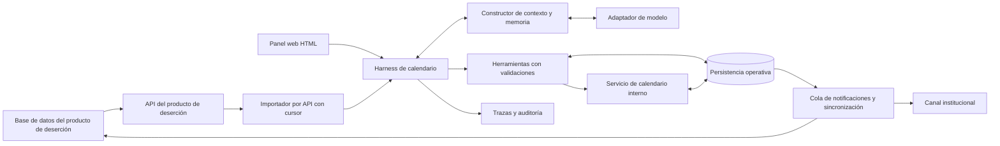

# Spec — Harness de calendario para el agente de deserción

Versión: 0.5 — conexión vLLM verificada y presupuestos de tokens calculados con mediciones. Fecha: 23 de octubre de 2026.

Decisiones confirmadas por el usuario: el MVP tendrá calendario propio, consumirá mediante API los datos generados por el producto de deserción y reservará automáticamente según reglas configuradas. Google Calendar y Outlook quedan para una posible fase posterior.

Documentos complementarios: [análisis y protocolo A/B](analisis-ab-harness.md) y [rutas por costo](rutas-por-costo.md). La configuración aportada identifica el modelo objetivo como `Qwen/Qwen3-8B-AWQ`, servido por vLLM en la red institucional. Corrige la denominación provisional «Qwen 3.8 de 8B»: corresponde a Qwen3 de 8B con cuantización AWQ. La revisión de pesos y configuración efectiva del servidor aún deben registrarse.

Vista explicativa: [flujo interactivo del harness](../web/index.html), con arquitectura, simulación de casos ficticios, reglas de prioridad y desempate, explorador de tokens, fases y criterios de aceptación. Esta vista documenta la lógica y no sustituye la implementación operativa del calendario.

## 1. Propósito y resultado esperado

Construir un harness de calendario conectado al producto existente de agente de deserción para convertir necesidades de seguimiento estudiantil en citas de 15 minutos con asesores. Debe consultar estudiantes elegibles, aplicar prioridades, encontrar disponibilidad real, proponer o ejecutar reservas conforme a una política autorizada, registrar el resultado y gestionar confirmaciones, reprogramaciones y cancelaciones.

El harness es el entorno de ejecución del agente: integra modelo, contexto, instrucciones, herramientas, persistencia, validaciones, recuperación ante fallos y observabilidad. Su entrega incluye una interfaz HTML que permita observar y operar el flujo.

Este documento define el sistema; no implica que ya exista una integración funcional ni que las decisiones pendientes estén aprobadas.

## 2. Interpretación de las imágenes

| Referencia | Lectura | Consecuencia para el spec |
|---|---|---|
| Imagen 1: harness general | LLM rodeado de contexto, tools/skills, base de datos, historial, compactación y mecanismos RAG/CAG. WhatsApp y certificados aparecen como ejemplo de interacción. Algunas anotaciones manuscritas no son inequívocas. | Conservar la estructura del runtime; adaptar el caso de uso a calendario. No incorporar certificados como funcionalidad requerida. No convertir cifras manuscritas de tokens ni un nombre de modelo en requisitos cerrados. |
| Imagen 2: requisitos del spec | Stack técnico, contexto por modelo, posibilidad de varios modelos, HTML del harness, documentación inicial y fases. | Especificar arquitectura, política de contexto por modelo, interfaz observable, documentación y entregables por fase. |
| Imagen 3: propuesta funcional | Estudiantes priorizados por riesgo, Qwen3:8B/Ollama, herramientas, agenda de asesor, citas de 15 minutos y mensajes. | Base del dominio funcional. Falta concretar contratos, autorización de reservas, concurrencia y recuperación ante fallos. |
| Imagen 4: prototipo n8n | Trigger manual, lectura de Google Sheets, bucle y AI Agent con Gemini. | Punto de partida de una prueba. Sheets puede ser un adaptador de entrada de demostración. No se observa una herramienta de calendario conectada. El error visible requiere configuración o logs para diagnosticarlo. |

Qwen/Ollama y Gemini representan alternativas presentes en las imágenes originales. La configuración posterior fija `Qwen/Qwen3-8B-AWQ` mediante vLLM como modelo principal del MVP; Ollama no es una dependencia. No se requiere ejecutar varios modelos en cada solicitud.

## 3. Alcance

### MVP

- Lectura mediante API de los datos que el producto de deserción genera en su base de datos, sin acceso directo del harness a esa base.
- Consulta de estudiantes elegibles y priorización reproducible.
- Asignación a asesor según relaciones y reglas institucionales configuradas.
- Calendario propio: horarios semanales, bloqueos y disponibilidad calculada dentro del sistema.
- Reserva automática según reglas; creación, reprogramación y cancelación de citas internas.
- Persistencia del vínculo entre caso de origen y cita interna.
- Confirmación operativa y un canal de notificación por seleccionar.
- Vista web HTML del harness, panel del asesor e historial de operaciones.
- Gestión de contexto por modelo, trazas, reintentos y pruebas del flujo completo.
- Harness de desarrollo reproducible, instrucciones breves, fixtures y evaluación A/B una vez disponible el esqueleto funcional.
- Selección de ruta por costo y límites acumulados por tarea, con corte y reporte al agotarlos.

### Posterior al MVP

- Integración opcional con Google Calendar u Outlook y canales adicionales de mensajería.
- Conversación directa con estudiantes por WhatsApp, si se requiere.
- RAG para políticas institucionales extensas; adjuntos o capacidades multimodales cuando exista un caso concreto.
- Optimización de asignación entre múltiples asesores y campañas de gran volumen.

### Fuera del alcance inicial

- Entrenar, recalcular o modificar el modelo de probabilidad de deserción.
- Reemplazar el producto de deserción o construir un sistema académico completo.
- Emitir certificados u otros trámites ilustrados en el harness general.

## 4. Actores y responsabilidades

| Actor | Responsabilidad |
|---|---|
| Producto de deserción | Entregar casos, identificadores estables, riesgo y versión/fecha de su evaluación; recibir el estado de seguimiento. |
| Asesor | Mantener horarios y bloqueos, revisar prioridades, consultar su agenda, gestionar excepciones y registrar asistencia. |
| Estudiante | Recibir información de la cita y, si el canal lo permite, confirmar, rechazar o solicitar otro horario. |
| Administrador | Configurar asesores, horarios, reglas, modelos, credenciales y políticas de operación. |
| Harness | Coordinar herramientas y conversación, aplicar validaciones, mantener estados y registrar resultados. |

El LLM interpreta solicitudes y redacta respuestas. El código aplica elegibilidad, prioridad, permisos, horarios, idempotencia y transiciones. El LLM no escribe SQL arbitrario ni modifica el riesgo académico.

## 5. Decisiones iniciales y pendientes

Los siguientes valores permiten diseñar y probar el borrador; no sustituyen decisiones institucionales.

| Decisión | Propuesta inicial | Estado |
|---|---|---|
| Duración de cita | 15 minutos | Derivada de imagen 3 |
| Zona horaria de demostración | America/Guayaquil; persistir instantes en UTC y zona de agenda | Validar por sede |
| Autonomía | Reservar automáticamente con reglas configuradas; sin aprobación por cada cita | Confirmado por el usuario |
| Calendario | Calendario propio del sistema, sin Google Calendar ni Outlook en el MVP | Confirmado por el usuario |
| Origen de casos | API que expone los resultados almacenados por el producto de deserción | Confirmado; contrato y disponibilidad de la API por validar |
| Modelo | `Qwen/Qwen3-8B-AWQ` mediante servidor institucional vLLM | Identidad servida verificada; contexto efectivo 8192; nueve mediciones sintéticas completadas. Revisión de pesos, tools, calidad y concurrencia pendientes |
| Notificaciones | Un canal institucional; proveedor y condiciones por definir | Pendiente |
| Riesgo | Consumir score normalizado 0–1 y etiqueta opcional | Confirmar escala del origen |
| Capacidad | Usuarios simultáneos, asesores, estudiantes por lote y SLA | Pendiente de dimensionamiento |

La reserva automática está autorizada como comportamiento del producto. Antes de activarla deben existir una política configurada y un actor de servicio con permisos. Si faltan reglas necesarias, el caso queda pendiente; no se solicita aprobación del asesor en cada reserva válida.

## 6. Arquitectura propuesta



Stack propuesto para implementación: TypeScript/Node.js para API y runtime, PostgreSQL para estado operativo, HTML/CSS/TypeScript para la vista web y n8n para ingesta de lotes, disparadores y coordinación de integraciones. Se adopta como propuesta de diseño, sujeta al stack real del producto existente.

n8n puede alojar el prototipo con AI Agent y herramientas de subworkflow. Para el MVP, el servicio de agendamiento concentra las invariantes y la persistencia; los flujos n8n llaman ese servicio. Esto evita duplicar reglas en distintos nodos y permite probar concurrencia y reintentos.

El disparador manual de la imagen 4 se conserva para demostración. La integración del MVP consulta la API del producto mediante una acción manual o un proceso periódico con cursor/checkpoint persistido. Un webhook sería una ampliación opcional si el producto lo ofrece. Sheets queda solo como referencia del prototipo de la imagen, sin ser una dependencia del MVP. La ejecución por lote respeta prioridad, límites y resultados parciales por estudiante.

### Calendario propio: funcionamiento y límites

El sistema calcula disponibilidad como horario laboral del asesor menos bloqueos y citas activas, aplicando duración, buffers, ventana de búsqueda y zona horaria. El asesor o administrador mantiene horarios semanales, ausencias y bloqueos puntuales; la vista web ofrece agenda diaria/semanal y navegación por fechas.

La base operativa es la fuente de verdad de las citas del MVP. No existe sincronización externa: una reunión registrada exclusivamente fuera del sistema no ocupa automáticamente una franja aquí. Para que afecte la disponibilidad, el asesor debe registrar un bloqueo interno. El calendario es funcional y persistente, no una simulación visual.

## 7. Flujo funcional

1. Consultar la API del producto e importar casos con `case_id`, `student_id`, riesgo, fecha de evaluación y versión del origen. Procesar páginas y guardar checkpoints solo después de persistirlas correctamente.
2. Validar autenticidad, esquema, vigencia e identidad. Si falta información necesaria, registrar `requiere_revision` sin reservar.
3. Comprobar elegibilidad y citas activas existentes para ese caso.
4. Seleccionar el conjunto de reglas institucionales vigente y registrar su versión. Aplicar sus umbrales y excepciones para priorizar los casos por riesgo de deserción descendente. Ante igual prioridad, desempatar por orden alfabético ascendente del estudiante: primero apellidos y después nombres, con comparación en español sin distinguir mayúsculas ni acentos. Si coinciden apellidos y nombres, utilizar el identificador del caso como último criterio estable. La API de origen debe proporcionar los nombres y apellidos necesarios para aplicar esta regla; si faltan, registrar el caso para revisión sin inventarlos. La selección de reglas y el ordenamiento se ejecutan en código, no quedan a criterio del LLM.
5. Resolver el asesor habilitado. Sin una asignación válida, dejar el caso pendiente de revisión.
6. Consultar calendario y horarios institucionales; generar franjas de 15 minutos dentro de una ventana configurable. No inventar disponibilidad ni prometer una hora sin consultar herramientas.
7. Seleccionar automáticamente la primera franja válida según la política y registrar la versión de reglas aplicada. La selección es provisional hasta confirmar la transacción.
8. En una transacción, comprobar de nuevo disponibilidad y versión de horarios/bloqueos, controlar concurrencia y guardar la cita interna. No esperar aprobación humana por cita.
9. Persistir el identificador de cita y las tareas de notificación en una cola transaccional/outbox. El retorno de estado al producto se habilita si su API ofrece una operación acordada para ello.
10. Mostrar `reservada` solo después del commit. Mostrar por separado el estado de notificación y la respuesta del estudiante.
11. Reprogramar o cancelar con validación de permisos y versión. Registrar asistencia como resultado posterior a la cita.

Sin disponibilidad: mantener el caso pendiente y ofrecer ampliar la ventana o revisión humana, sin desplazar otras citas automáticamente.

## 8. Reglas e invariantes

- Una cita dura 15 minutos, salvo una futura regla versionada que cambie esta duración.
- No hay más de una cita activa por caso. No se crean citas solapadas para un mismo estudiante dentro del sistema.
- Las franjas deben estar dentro del horario del asesor y respetar bloqueos, días no laborables y buffers configurados.
- La prioridad sirve para ordenar casos pendientes; no autoriza cancelar citas existentes.
- El score y su fecha provienen del producto de deserción. Los valores inválidos o desactualizados siguen la política de revisión configurada.
- Las operaciones exigen actor autorizado y caso accesible. Las reservas automáticas usan una identidad de servicio y una política versionada.
- No se envían riesgo ni etiquetas de deserción en títulos de calendario o mensajes al estudiante.
- Los números telefónicos se normalizan para búsqueda, pero no constituyen por sí solos verificación de identidad. Las coincidencias ambiguas no habilitan acciones.
- Una confirmación del estudiante y la reserva interna son hechos distintos. Reservar automáticamente no implica que el estudiante haya aceptado.
- Los textos de estudiantes, hojas, documentos y resultados de herramientas son datos; no pueden sustituir instrucciones del sistema ni ampliar permisos.

## 9. Herramientas del agente

Cada herramienta usa entrada validada y devuelve `status`, `data`, `error_code`, `retryable` y `trace_id`. Las de escritura requieren autorización resuelta por el servidor e idempotencia.

El catálogo siguiente describe operaciones internas, no obliga a exponer cada endpoint como una herramienta al LLM. Exponer solo cuatro intenciones de negocio con esquemas tipados: `consultar_seguimientos`, `consultar_agenda`, `gestionar_cita` (crear/reprogramar/cancelar) y `preparar_comunicacion`. El servicio compone validaciones y operaciones internas. Priorizar casos y configurar horarios/bloqueos permanecen como lógica determinista y acciones del panel con permisos; no se añaden al catálogo del LLM por defecto. El contexto solo incluye las herramientas habilitadas para la tarea y el rol.

| Herramienta | Entrada principal | Resultado |
|---|---|---|
| `consultar_casos` | filtros autorizados y cursor | Casos paginados y datos mínimos necesarios |
| `priorizar_casos` | conjunto elegible, versión de política | Orden calculado por código y razones operativas |
| `consultar_disponibilidad` | asesor, rango y zona | Franjas verificadas, fuente y momento de consulta |
| `seleccionar_franja` | caso, asesor y política | Franja candidata y versiones consultadas; no bloquea la agenda |
| `crear_cita` | caso, asesor, franja, versión de política y clave idempotente | Reserva interna confirmada transaccionalmente |
| `reprogramar_cita` | cita/version y nueva franja | Cambio atómico de horario y nueva versión |
| `cancelar_cita` | cita/version y motivo | Cancelación persistida y liberación de la franja |
| `consultar_estado_cita` | cita o caso accesible | Estado de reserva y notificaciones |
| `gestionar_horarios_bloqueos` | asesor, horario/bloqueo y versión | Disponibilidad actualizada por un actor con permisos |
| `preparar_notificacion` | cita y plantilla aprobada | Mensaje para la cola, sin afirmar entrega |
| `registrar_resultado` | cita/version y asistencia | Resultado de seguimiento y tarea de sincronización |

Las skills, si se implementan, son procedimientos versionados como «agendar seguimiento» o «resolver reprogramación» que usan estas herramientas. Una skill no añade permisos de escritura por sí misma.

## 10. Contexto, memoria y modelos

El constructor de contexto prepara por solicitud: instrucciones del sistema versionadas, política vigente, actor/rol, caso activo, estado estructurado, resumen previo, mensajes recientes y resultados relevantes de herramientas.

La ficha de cada modelo registra proveedor, identificador y versión fijados, contexto máximo soportado y contexto realmente configurado, límite de salida, contador/estimador de tokens, soporte de herramientas, timeout, ubicación de ejecución y política de datos. Los candidatos deben superar las mismas pruebas antes de habilitarse.

La consulta real a `/v1/models` confirmó `max_model_len=8192` para Qwen3-8B-AWQ. Esta es la ventana efectiva del MVP, aunque la ficha pública admita más. Aplicar por llamada `entrada_completa + salida_maxima + margen <= 8192`, con margen inicial de 820 tokens y techo global de entrada de 5734. Los límites más restrictivos de cada ruta se definen en rutas-por-costo.md. Contar la plantilla completa y herramientas; los resultados de tools y el historial reenviado consumen entrada de nuevo.

Presupuesto inicial propuesto: reservar al menos 20 % de la ventana configurada para salida y continuación; compactar antes de que la entrada supere 70 %. Son parámetros de operación a ajustar con mediciones, no límites atribuidos a las imágenes o a un proveedor. Acotar resultados de herramientas con paginación. Si un bloque esencial no cabe, reducir la consulta o detener el turno con un estado explícito.

La compactación por exceso de contexto es un paso de recuperación, no un estado final: compactar → reconstruir contexto → contar de nuevo → validar la ventana y los límites de la ruta → continuar con Qwen y las herramientas. Superar la ventana por llamada no produce por sí solo `budget_exceeded`. Este último corresponde al agotamiento real del presupuesto acumulado de la tarea (tokens, llamadas o plazo), que compactar no reinicia. Si el contenido esencial sigue sin caber tras reducirlo, dividir la tarea o solicitar el dato necesario; no repetir compactaciones sin reducción ni perder información crítica para forzar la continuación.

Mantener inicialmente hasta 10 mensajes recientes cuando quepan; el presupuesto de tokens tiene prioridad sobre el número de mensajes. La compactación conserva decisiones, citas, aprobaciones, identificadores y pendientes, y se guarda con trazabilidad al historial. Los hechos críticos se rehidratan desde la base y el calendario; el resumen no es fuente de autorización ni de disponibilidad.

La memoria se particiona por institución, sesión, actor y caso, con controles de acceso. Cambiar de estudiante requiere reconstruir el contexto. Cambiar de modelo requiere reconstruirlo con su presupuesto y esquema de herramientas; no se trasladan credenciales ni razonamientos internos.

Interpretación de RAG/CAG para este proyecto: recuperar por RAG políticas relevantes cuando el corpus lo justifique; incluir directamente un paquete pequeño y versionado de instrucciones institucionales si se adopta el enfoque rotulado CAG en la imagen. No enviar toda la base estudiantil ni todos los documentos en cada turno. Confirmar el significado esperado de CAG antes de implementarlo.

Un modelo alternativo es opcional. No repetir una escritura porque falle el modelo o se cambie de proveedor; primero consultar el resultado de la operación anterior. El acceso a modelos remotos depende de la política institucional de datos.

## 11. Persistencia y estados

Entidades mínimas:

- `students`: referencia externa, institución y contactos mínimos autorizados.
- `followup_cases`: referencia de origen, riesgo/fecha/versión, asesor y estado de seguimiento.
- `advisors`: identidad, zona y reglas de asignación.
- `advisor_working_hours`: horario semanal, vigencia, zona y versión.
- `calendar_blocks`: asesor, inicio/fin, motivo operativo y versión.
- `appointments`: caso, asesor, inicio/fin UTC, zona, estado, versión y política que autorizó la reserva.
- `import_checkpoints`: origen, cursor/marca de actualización y último lote persistido.
- `sessions`, `messages`, `context_summaries`: memoria segregada y auditable.
- `operations`: clave idempotente, hash de solicitud, resultado y fase de ejecución.
- `outbox`: tareas de sincronización/notificación, intentos y próximo reintento.
- `audit_events`: actor, acción, referencias, timestamp y `trace_id`.

Separar tres estados:

| Dimensión | Valores iniciales |
|---|---|
| Reserva | reservada, cancelada |
| Caso de seguimiento | pendiente, procesando, agendado, sin_disponibilidad, requiere_revision, cerrado |
| Notificación | pendiente, enviada, entregada_si_el_proveedor_lo_acredita, fallida |
| Respuesta/asistencia | sin_respuesta, aceptada, rechazada; asistencia pendiente, asistio, no_asistio |

La selección de una franja no equivale a una reserva. `reservada` requiere una cita confirmada en la base interna. Creación, reprogramación y cancelación son operaciones atómicas: ante un rollback se conserva el estado anterior. Cada transición valida estado previo y versión y se registra. Un fallo de mensajería no elimina una reserva.

## 12. Contrato de integración propuesto

El producto de deserción expone su base mediante API y el harness la consume. El siguiente contrato es una propuesta; las rutas y campos reales deben acordarse y no se presuponen disponibles. El harness mantiene una copia operativa mínima y no recalcula el riesgo ni escribe directamente en la base de origen.

Lectura propuesta: `GET /api/followup-cases?updated_since={marca}&cursor={cursor}&limit={limite}`. Respuesta con `items`, `next_cursor` y una marca de corte consistente del origen. Cada elemento necesita un identificador estable y versión o timestamp de actualización; la paginación no debe omitir registros con igual timestamp. La importación hace upsert por institución/caso y versión: releer un lote no crea otra cita ni reprograma una existente por un simple cambio de score. Cambios que invaliden la elegibilidad de un caso ya agendado generan revisión según política, sin cancelación implícita.

Ejemplo de registro normalizado interno; `event_id` es opcional y solo aplica si después se incorporan eventos:

```json
{
  "event_id": "evt_demo_001",
  "event_type": "followup.requested",
  "schema_version": "1",
  "institution_id": "institucion_demo",
  "case_id": "caso_demo_001",
  "student_id": "estudiante_demo_001",
  "risk": { "score": 0.87, "assessed_at": "2026-10-23T14:00:00Z", "version": "v1" },
  "assigned_advisor_id": "asesor_demo_001"
}
```

- `POST /integrations/dropout/import`: iniciar lectura de la API de origen; devolver `202` con `operation_id`.
- `GET /cases/{case_id}/appointments`: estado accesible desde el producto y el panel.
- `GET /advisors/{id}/availability`: franjas calculadas desde horario, bloqueos y reservas internas.
- `PUT /advisors/{id}/working-hours`: configurar horario semanal con control de versión.
- `POST /advisors/{id}/blocks` y `DELETE /advisors/{id}/blocks/{block_id}`: gestionar bloqueos con autorización.
- `POST /appointments`: reservar automáticamente tras validar reglas y disponibilidad en una transacción.
- `POST /appointments/{id}/reschedule` y `/cancel`: comandos versionados e idempotentes.
- Consulta de resultados: devolver `case_id`, `appointment_id`, estado, versión y `occurred_at`. Retorno al producto por API/callback es opcional hasta confirmar que admite escritura; el MVP no depende de ella para reservar.

Autenticación entre servicios mediante mecanismo institucional acordado; autorización por institución y rol. Los comandos usan `Idempotency-Key`; misma clave con distinto payload devuelve conflicto. Respuestas de error diferencian datos inválidos, acceso denegado, conflicto de horario, versión desactualizada y fallo temporal de la API de origen.

## 13. Concurrencia y recuperación

La consulta de disponibilidad no bloquea una franja. Al reservar: abrir una transacción, serializar las mutaciones de agenda por asesor, volver a validar horarios/bloqueos y reservas, y guardar cita, operación y outbox en el mismo commit. Aplicar además restricciones de no solapamiento por asesor y estudiante, considerando los buffers configurados. Una clave única de hora de inicio no basta para impedir intervalos parcialmente superpuestos.

La creación de bloqueos y la edición de horarios usan el mismo control de concurrencia que las reservas. Un bloqueo o cambio de horario incompatible con citas activas devuelve conflicto y exige resolver esas citas explícitamente; no las cancela en silencio. Una reprogramación libera la franja anterior y ocupa la nueva en una única transacción; si falla conserva la cita anterior.

Si la respuesta se pierde después del commit, consultar/repetir la operación con la misma clave idempotente recupera el resultado sin duplicar la cita. Reintentos limitados con espera progresiva para fallos temporales; errores permanentes y casos agotados pasan a revisión. Las integraciones externas futuras tendrán su propio mecanismo de conciliación, fuera del alcance de este MVP.

El outbox permite reservar aunque falle el retorno de estado o el canal de mensajes. Debe ser visible qué se completó, qué sigue pendiente y quién debe intervenir.

## 14. Interfaz HTML del harness

La interfaz solicitada en la imagen 2 es parte del entregable y funciona con datos de ejecución reales durante el MVP.

1. **Casos y prioridades:** filtros por asesor, sede y estado; riesgo solo para roles autorizados; explicación de prioridad y pendientes.
2. **Agenda interna:** vista diaria/semanal, citas automáticas, horarios laborales, bloqueos, zona horaria, reprogramación y cancelación según rol; sin paso de aprobación por cita.
3. **Inspector de ejecución:** `trace_id`, modelo y versión de prompt, etapas, herramientas/argumentos sanitizados, resultados, tokens estimados o reportados y tiempos.
4. **Contexto:** resumen, mensajes recientes, fuentes recuperadas, presupuesto y eventos de compactación; nunca credenciales ni razonamiento interno del modelo.
5. **Operación:** errores, tareas pendientes, notificaciones, última importación por API, checkpoints y reintentos autorizados.

El diagrama de ejecución incorpora consumo por etapa: entrada preparada, salida reservada, margen y ocupación de la ventana; entrada enviada y salida generada acumuladas; total, llamadas, tiempo de inferencia y presupuesto restante. Distinguir valores medidos, estimados y simulados. Preparar contexto o consultar un nodo no consume inferencia; las operaciones deterministas O0 suman cero tokens del modelo. Los resultados de herramientas cuentan como entrada solo cuando se reenvían a una nueva llamada. Una compactación con LLM suma su propia entrada/salida y tiempo; el contexto se reduce, pero el consumo acumulado no disminuye ni se reinicia. En el runtime, las cifras deben proceder del tokenizador y de `usage` de cada respuesta, correlacionadas por `trace_id`.

La vista HTML actual implementa este panel como simulación paso a paso, utilizando volúmenes y tiempos de referencia de las nueve mediciones guardadas. No realiza nuevas inferencias ni debe presentarse como telemetría de un calendario operativo.

Estados de carga, vacío, éxito, conflicto y error deben ser explícitos. La vista indica si usa datos de prueba o datos operativos y comunica que la agenda es interna. El asesor no accede por defecto a información de otros asesores o instituciones.

## 15. Observabilidad y validación

Cada ejecución correlaciona evento de origen, sesión, caso, llamadas de herramientas, operaciones externas y notificaciones mediante `trace_id`. Medir latencia por etapa, porcentaje de reservas exitosas, conflictos, duplicados evitados, reintentos, fallos de notificación, uso de tokens y compactaciones. No guardar secretos ni contenidos sensibles innecesarios en logs.

Pruebas de aceptación del MVP:

| ID | Escenario | Evidencia de aceptación |
|---|---|---|
| A01 | Caso válido y franja libre | Cita interna de 15 minutos persistida y visible en la agenda del asesor. |
| A02 | Lote con riesgos distintos y casos empatados | Se registra la versión de reglas aplicada; riesgo descendente y, ante igual prioridad, orden alfabético por apellidos y nombres. Nombres idénticos se resuelven por identificador de caso; nombres faltantes pasan a revisión. El score de origen no se modifica. |
| A03 | Reserva automática | Con reglas completas se reserva sin aprobación humana; reglas faltantes o incumplidas impiden reservar. |
| A04 | Evento o comando repetido | Una sola operación efectiva y una cita activa por caso. |
| A05 | Dos solicitudes simultáneas a la misma franja | Como máximo una reserva creada por el servicio; la otra informa conflicto. |
| A06 | Otra reserva o bloqueo cambia la agenda tras consultar | La validación transaccional detecta el conflicto; no se guarda una cita solapada. |
| A07 | Timeout después del commit | La misma clave idempotente recupera la cita existente sin duplicarla. |
| A08 | Mensajería o callback falla | Reserva conservada, tarea pendiente visible y reintento sin duplicados evitables. |
| A09 | Reprogramar y cancelar | La agenda refleja el cambio atómico; una reprogramación fallida conserva la reserva anterior. |
| A10 | Cambio de estudiante o acceso indebido | No se mezcla contexto y se rechaza acceso no autorizado. |
| A11 | Historial excede la ventana de contexto por llamada | Se compacta conservando referencias y pendientes, se reconstruye y cuenta de nuevo y se continúa con Qwen cuando cabe; la compactación no finaliza la tarea ni reinicia su consumo acumulado. |
| A12 | Datos incompletos, sin asesor o sin disponibilidad | No se inventan hechos ni se reserva; el caso indica el motivo y la siguiente acción. |
| A13 | Texto externo intenta ordenar cambios | No altera políticas ni ejecuta herramientas fuera de autorización. |
| A14 | Panel y agente | Una ejecución puede seguirse de principio a fin mediante su traza y consumo por etapa. Contexto/reserva de salida se separan de tokens consumidos; O0 no suma inferencia y compactar con LLM acumula su consumo sin borrar el anterior. El origen medido/estimado/simulado de los valores es visible. |
| A15 | Importación paginada, repetida o interrumpida | Se reanuda sin omitir casos ni duplicar citas; una actualización de riesgo no reprograma por sí sola. |
| A16 | Horarios y bloqueos | La disponibilidad excluye ausencias y ocupación; cambios incompatibles con reservas activas devuelven conflicto. |
| A17 | Ruta sin necesidad de lenguaje natural | Importación y reserva estructurada usan O0, sin llamadas al modelo. |
| A18 | Presupuesto agotado o escalado de modelo | Se detienen nuevas llamadas, se conserva consumo acumulado y se reporta `budget_exceeded` con efectos ya persistidos. |
| A19 | Herramientas expuestas al LLM | Solo las intenciones autorizadas; endpoints internos y configuración administrativa no aparecen como tools crudas. |
| A20 | Reproducibilidad de desarrollo | Un checkout limpio instala versiones fijadas y ejecuta comandos documentados y fixtures sin alias locales. |
| A21 | Ciclo de verificación | Suite rápida crítica tarda menos de 60 s en el entorno de referencia documentado; suite completa se ejecuta en CI. |
| A22 | Protocolo A/B | Corridas con mismo modelo/configuración, aislamiento, evaluación independiente y resultados completos; no se declaran mejoras sin evidencia. |

Primero probar con datos sintéticos y un simulador de la API de origen; después ejecutar el flujo completo contra la API de prueba del producto y la base operativa del calendario interno. No se necesita una cuenta Google/Outlook. La aceptación del modelo exige interpretar solicitudes de agenda en español y usar herramientas válidas en los casos críticos; la corrección de reservas sigue dependiendo de validaciones del servicio.

## 16. Fases y entregables

| Fase | Trabajo | Condición de cierre |
|---|---|---|
| 0. Definición | Conocer API/esquema del producto, horarios, permisos y datos de prueba. | Contrato y reglas validados; calendario interno y autonomía automática ya confirmados. |
| 1. Harness observable | Runtime, herramientas simuladas, adaptador de modelo, contexto, memoria, rutas O0/O1/O2 e interfaz HTML; instrucciones y fixtures de desarrollo. | Caso simulado trazable completo, compactación, presupuestos y errores visibles; scripts verificados en checkout limpio. |
| 2. Integración de casos | Consumo API, paginación/checkpoints, prioridad y persistencia operativa. | Lote reproducible sin duplicados, identidad estable y A15 verificada. |
| 3. Calendario interno | Horarios, bloqueos, disponibilidad, reservas automáticas, modificaciones y cancelación. | A01–A07, A09 y A16 pasan con persistencia real. |
| 4. Comunicación y retorno | Outbox, canal institucional; retorno a deserción si su API lo admite. | Fallos parciales recuperables y estado accesible por API/panel. |
| 5. Piloto | Accesos, pruebas restantes, A/B, comparación de modelos/costes, documentación y operación supervisada. | A01–A22 verificadas y criterios de capacidad acordados con mediciones. |

No se asignan plazos sin conocer infraestructura, accesos, volumen y estado del producto existente.

## 17. Documentación inicial requerida

- README con instalación, configuración y ejecución de demostración.
- Arquitectura y decisiones de stack/modelo; versiones fijadas para reproducibilidad.
- Contratos API, herramientas, estados, permisos e idempotencia.
- Catálogo de prompts/políticas y estrategia de contexto por modelo.
- Export de workflows n8n sin secretos y variables de entorno de ejemplo sin valores reales.
- Guía de configuración de horarios, bloqueos y reglas automáticas; guía de importación por API, credenciales del origen, conflictos y reintentos.
- Registro de pruebas de aceptación, conjunto de datos sintéticos y limitaciones conocidas.
- AGENTS.md breve con comandos reales verificados y enlaces; instrucciones de setup desde checkout limpio, lockfile, scripts y fixtures versionados.
- Reportes A/B, configuración de presupuestos, ficha verificable de cada modelo y mediciones por ruta.

## 18. Fuentes técnicas consultadas

Estas fuentes respaldan capacidades técnicas; las reglas de negocio anteriores son propuestas de este spec.

- [n8n AI Agent](https://docs.n8n.io/integrations/builtin/cluster-nodes/root-nodes/n8n-nodes-langchain.agent/): el nodo coordina un modelo y herramientas; el prototipo debe conectar herramientas concretas para actuar.
- [Ficha oficial Qwen3-8B-AWQ](https://huggingface.co/Qwen/Qwen3-8B-AWQ): modelo identificado en la configuración compartida, con cuantización AWQ de 4 bits.
- [Despliegue vLLM de Qwen](https://qwen.readthedocs.io/en/latest/deployment/vllm.html): protocolo compatible, control de thinking y configuración de herramientas.
- [Tool calling en vLLM](https://docs.vllm.ai/en/stable/features/tool_calling/): requisitos de servidor para llamadas de herramientas; su habilitación efectiva está pendiente de comprobar.
- [Precios oficiales Gemini](https://ai.google.dev/gemini-api/docs/pricing): comparación con referencias API en rutas-por-costo.md.
- [Referencia de Google Calendar](https://developers.google.com/workspace/calendar/api/v3/reference): referencia consultada en v0.1; integración descartada para el MVP y conservada solo como posible ampliación.

## 19. Preguntas para cerrar la siguiente versión

1. ¿Cuántos asesores utilizarán la agenda interna y quién mantendrá sus horarios y bloqueos?
2. ¿La API del producto ya existe? Se necesita su documentación o una respuesta de ejemplo, autenticación, identificadores, escala del riesgo y mecanismo de paginación/actualizaciones.
3. ¿Qué reglas exactas habilitan una reserva automática: elegibilidad, asignación de asesor, anticipación, ventana de búsqueda y máximo de citas por día?
4. ¿Canal inicial: correo, WhatsApp o solo panel? ¿Existe proveedor conectado?
5. ¿Qué horarios, umbrales de riesgo, vigencia del score, ventana de búsqueda, buffers y excepciones aplican?
6. ¿Qué versión de vLLM, revisión de pesos, `max_model_len`, hardware y configuración de tool calling tiene el servidor? ¿Qué datos pueden enviarse a modelos externos alternativos?
7. ¿Se esperan conversaciones entrantes o solo campañas de agendamiento? ¿Volumen y tiempos de respuesta esperados?
8. ¿Quién registra asistencia y cómo impacta ese resultado en el producto de deserción?

## 20. Harness de desarrollo y antipatrones

La tercera imagen se incorpora como requisitos de ingeniería. El harness de desarrollo orienta al agente que construye este repositorio y se distingue del runtime del calendario. Su prueba se define en [analisis-ab-harness.md](analisis-ab-harness.md).

| Antipatrón | Requisito para este proyecto | Evidencia |
|---|---|---|
| AGENTS.md que intenta explicarlo todo | Una página breve, objetivo ≤100 líneas: propósito, mapa de módulos, comandos exactos y enlaces al detalle. Evitar historia extensa y duplicación del spec. | Revisión de legibilidad, enlaces y ejecución de comandos desde checkout limpio. |
| Tests que tardan demasiado para iterar | Suite rápida por defecto con casos críticos, objetivo <60 s en entorno documentado; suite completa y pruebas más lentas en CI. | Tiempo medido y comandos separados; mantener evaluación de concurrencia e idempotencia en la verificación apropiada. |
| Muchas herramientas crudas | Cuatro intenciones de negocio expuestas al LLM; composición y operaciones internas en código. | Inventario de tools real por rol y pruebas de esquemas/autorización. |
| Harness que solo funciona en una máquina | Versionar instrucciones, prompts, políticas, herramientas, scripts, fixtures, dependencias y ejemplos de configuración sin secretos. | Setup reproducible, lockfile, export n8n sin credenciales y smoke test en entorno limpio. |

No se documentan comandos ficticios como si ya funcionaran. El futuro AGENTS.md debe contener los scripts comprobados de instalación, arranque, carga de datos sintéticos, test rápido, test completo y lint cuando exista la aplicación. La configuración debe ser portable y no depender de alias de shell o rutas personales; secretos se inyectan por entorno.

Revisar el harness en cada retrospectiva y después de fallos de uso: comandos obsoletos, duración de tests, ruido de contexto, tools innecesarias, costes y correcciones humanas. Cada cambio de prompt, catálogo o modelo debe tener versión y pasar la regresión correspondiente. Los scripts de reset/destrucción quedan excluidos del paquete de herramientas del agente y del laboratorio ordinario.

## 21. Política de rutas y costos

Aplicar [rutas-por-costo.md](rutas-por-costo.md): O0 determinista para campañas y operaciones estructuradas; O1 para interpretación/redacción acotada; O2 solo para excepciones justificadas. La reserva automática no exige una llamada al LLM por estudiante. R0/R1/R2 se reservan para desarrollo y evaluación, sin delegación automática.

La configuración versionada define topes de entrada/salida por llamada, tokens acumulados, tiempo y llamadas por tarea. Costo en este MVP significa consumo de tokens y tiempo; el usuario no requiere un cálculo eléctrico ni monetario. Cambiar de modelo o reintentar no reinicia el consumo. El agotamiento corta nuevas acciones y reporta `budget_exceeded`, con artefactos, estado y efectos ya confirmados. El agente no puede afirmar éxito si faltan verificaciones.

El panel muestra ruta, causa de escalado, tokens de entrada/salida reales, salida reservada, contexto efectivo, llamadas, tiempo y presupuesto restante. La elección de ruta considera éxito verificado y consumo por resultado aceptado. Los tiempos propuestos se calculan a partir de las mediciones y no constituyen SLA; deben recalibrarse con carga y herramientas reales. La reserva estructurada usa O0 sin LLM; O1/O2 utilizan el mismo Qwen con thinking desactivado en el perfil medido.

## 22. Perfil de conexión confirmado por configuración

| Campo | Valor recibido | Estado |
|---|---|---|
| Modelo solicitado | `Qwen/Qwen3-8B-AWQ` | Identificado; contrastado con ficha oficial |
| Runtime | vLLM | Declarado por la configuración; versión pendiente |
| URL base | `http://172.16.8.69:8000/v1` | Conexión verificada desde este proyecto con permiso de red |
| Descubrimiento | `GET /v1/models` | Coincide el modelo servido; `max_model_len=8192` |
| Hardware | 4 tarjetas RTX 4000 y 128 GB de RAM | Informado por el usuario; variante/VRAM y uso efectivo de GPU pendientes |
| Generación | `POST /v1/chat/completions` | Compatible con el cliente utilizado en la demostración |
| Clave del ejemplo | `no-se-necesita` | Placeholder del cliente; no demuestra la autenticación efectiva del servidor |
| Temperatura | `0.3` | Punto inicial de la demostración; validar con evaluación |
| Thinking | `chat_template_kwargs.enable_thinking=false` por defecto | Perfil inicial O1; medir el modo true por separado, sin asumir mayor precisión |
| Streaming | Verificado con nueve solicitudes sintéticas | Cierre y usage recibidos; todavía sin integración de UI |
| Tokenización | `POST /tokenize` con plantilla y thinking=false | Coincide con prompt_tokens en nueve solicitudes |

Configurar URL, modelo y autenticación por entorno. El navegador no llama directamente a la IP del modelo: el backend del harness construye contexto, aplica presupuestos y envía las solicitudes. Los ejemplos ACME y reembolsos son datos de demostración; se reemplazan por el prompt del calendario y no se incorporan como políticas del producto.

El historial se mantiene en el harness y se reenvía de forma acotada en cada solicitud. La demostración no acredita memoria persistente, RAG, herramientas ni acciones de calendario. La compatibilidad con chat no demuestra tool calling habilitado: verificar parser, plantilla y opciones de la versión instalada mediante una herramienta simulada sin escrituras. No alterar el servidor sin conocer su configuración actual.

Además del ejemplo, el adaptador debe fijar timeout, máximo de salida y política de reintentos, validar esquemas, comprobar `finish_reason` y manejar errores, contenido vacío, `tool_calls` y chunks sin contenido. El consumo de thinking cuenta en el presupuesto de salida; no se muestra razonamiento interno en el panel. Para A/B, congelar todos estos parámetros.

La primera prueba fue bloqueada por permisos de socket; después, con el mecanismo de permisos de red, se completó el descubrimiento y nueve inferencias sintéticas. Se reportaron 26664 tokens de entrada y 2688 de salida; ninguna llamada excedió el contexto. Todas terminaron por el límite deliberado de salida (`length`): la medición no evalúa calidad ni representa citas realizadas. Evidencia en reports/llm/qwen-medicion.json y presupuestos derivados en reports/llm/qwen-rutas.json.

Se incorporaron scripts/medir_qwen.py, scripts/calcular_rutas.py y .env.example. El cliente cuenta y valida contexto antes de generar, mide streaming y guarda resultados; no ejecuta herramientas. El ejecutor de presupuestos persistentes por tarea y las herramientas de calendario aún deben construirse. Confirmar parser/tool calling con una herramienta simulada antes de habilitar escrituras.
