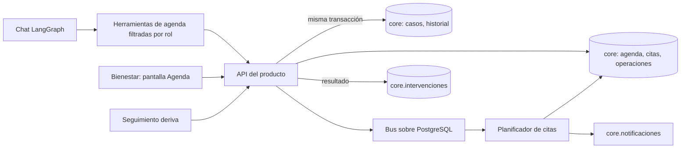
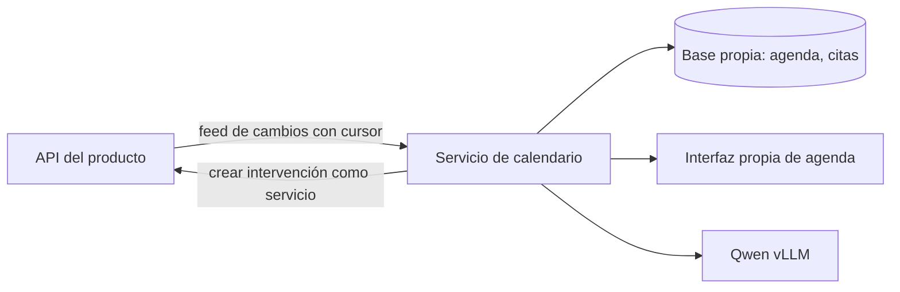

# Spec — Harness de calendario para el agente de deserción

Versión: 0.9 — especificación cerrada para empezar el MVP: contrato técnico (esquema SQL validado, endpoints, errores, algoritmos), valores del MVP y definición de listo (§34), sobre la alineación v0.8 con el Agente de Deserción v2 (disparo por derivación, prioridad del producto, sin nombres ni contacto, stack Python) y el harness de ejecución (§33). Fecha: 28 de octubre de 2026.

Estado: especificación de implementación. Las decisiones del usuario siguen vigentes salvo las que v0.8 suspende de forma explícita (§5). Las reglas técnicas nuevas son propuestas. Los valores institucionales no confirmados tienen campos obligatorios, responsables y condiciones de activación (§23, §30). La auditoría y su trazabilidad están en [auditoria-logica.md](auditoria-logica.md).

**Base de esta versión.** Revisión del código y la documentación del producto «Permanencia y acompañamiento estudiantil (UTI)», carpeta `Agente Desercion v2`, commit `fd64df2` con cambios locales, revisado el 28 de octubre de 2026. Las afirmaciones sobre el producto citan su SPEC_REFINADO v1.9, su bitácora y sus migraciones `0001`–`0010`. Si el producto cambia, esta sección y §32 deben revisarse.

Decisiones confirmadas por el usuario: el MVP tiene calendario propio, consume los datos del producto de deserción y reserva automáticamente según reglas, sin aprobación por cada cita. Google Calendar y Outlook quedan para una fase posterior.

Documentos complementarios: [contrato técnico de la agenda](contrato-tecnico-agenda.md), [propuesta de la Etapa 10](propuesta-etapa-10-agenda.md), [análisis y protocolo A/B](analisis-ab-harness.md), [rutas por costo](rutas-por-costo.md) y [calidad, tiempos y evals](calidad-evals.md). Modelo: `Qwen/Qwen3-8B-AWQ` servido por vLLM en la red institucional, el mismo servidor que ya usa el producto.

Vista explicativa: [flujo interactivo del harness](../web/index.html). Actualizada a la v0.8 y §33 el 28 de octubre de 2026: disparo por derivación, agenda de Bienestar, cierre y conciliación, asistente con presupuesto y trazas, y fases de la Etapa 10. Es una simulación; no sustituye la implementación.

Referencia normativa: este spec gobierna el comportamiento y [rutas por costo](rutas-por-costo.md) sus límites numéricos de tokens y tiempos. Un cambio de regla debe actualizar sus pruebas y documentos antes de habilitarse.

## 1. Propósito y resultado esperado

Convertir cada **derivación de Seguimiento a Bienestar** en una cita interna de 15 minutos con un profesional de Bienestar, reservada automáticamente según una política autorizada. Después, registrar el resultado de la cita como intervención en el producto, y mantener la cita coherente con el estado del caso: cancelarla si el caso se cierra, se descarta o el estudiante queda sin matrícula.

El harness es el entorno de ejecución del agente de calendario: integra modelo, contexto, herramientas, persistencia, validaciones, recuperación ante fallos y observabilidad. Incluye una interfaz para observar y operar la agenda.

Este documento define el sistema; no implica que ya exista una integración funcional ni que las decisiones pendientes estén aprobadas.

## 2. Interpretación de las imágenes

| Referencia | Lectura | Consecuencia para el spec |
|---|---|---|
| Imagen 1: harness general | LLM con contexto, tools/skills, base de datos, historial, compactación y RAG/CAG. WhatsApp y certificados aparecen como ejemplo. | Conservar la estructura del runtime y adaptarla a calendario. No incorporar certificados. |
| Imagen 2: requisitos del spec | Stack, contexto por modelo, HTML del harness, documentación y fases. | Especificar arquitectura, contexto, interfaz observable, documentación y entregables por fase. |
| Imagen 3: propuesta funcional | Estudiantes priorizados por riesgo, Qwen3:8B, herramientas, agenda de asesor, citas de 15 minutos y mensajes. | Base del dominio. v0.8 la ajusta al producto real: la agenda es de Bienestar y la priorización ya la hace el producto. |
| Imagen 4: prototipo n8n | Trigger manual, Google Sheets, bucle y AI Agent con Gemini. | Referencia histórica del prototipo. El producto real no usa n8n; v0.8 no lo adopta. |

## 3. Alcance

### MVP

- Detectar cada derivación de un caso a Bienestar y reservar una cita interna de 15 minutos con un profesional de Bienestar habilitado.
- Ordenar las derivaciones pendientes con la **misma prioridad que la bandeja del producto** (§23).
- Calendario propio de Bienestar: horarios semanales, bloqueos, días no laborables y disponibilidad calculada.
- Reprogramar y cancelar citas; cancelar automáticamente cuando el caso se cierra o queda `sin_matricula`. Descartar no aplica: el producto solo descarta casos `nuevo`, que nunca tienen cita.
- Registrar el resultado de la cita como **intervención del producto**, sin duplicar el registro.
- Avisar al profesional dentro de la aplicación (panel interno). El contacto con el estudiante lo hace una persona por los canales institucionales.
- Interfaz de agenda para Bienestar y estado de la cita visible para Seguimiento.
- Gestión de contexto, trazas, reintentos, presupuestos de tokens y el sistema de calidad de §31.

### Posterior al MVP

- Aviso directo al estudiante (correo, mensaje). Requiere una fuente de contacto que el producto hoy no tiene y una base legal aprobada (§28, P4).
- Google Calendar u Outlook.
- Respuesta del estudiante (confirmar, rechazar, pedir otro horario) por un canal propio.
- Agendamiento sin derivación previa para un nivel específico, si la institución lo decide expresamente.

### Fuera del alcance

- Calcular, recalibrar o modificar el riesgo, los niveles o los cupos de alertas.
- Decidir la derivación, descartar o cerrar casos: son decisiones de Seguimiento y Bienestar en el producto.
- Contactar al estudiante automáticamente.
- Certificados u otros trámites ilustrados en el harness general.

## 4. Actores y responsabilidades

| Actor | Responsabilidad |
|---|---|
| Producto de deserción | Fuente de verdad del caso: nivel, prioridad, estado, derivación, intervenciones e identidad cifrada. Publica los eventos del caso. |
| Seguimiento Estudiantil | Deriva o descarta casos en el producto. Ve el estado de la cita de los casos que derivó. |
| Profesional de Bienestar | Mantiene su horario y bloqueos, atiende la cita, contacta al estudiante y registra el resultado. |
| Coordinación de Bienestar | Asigna casos a profesionales cuando la política no lo resuelve sola; aprueba la política de agenda. |
| Administración | Configura horarios, políticas y modelos. Nunca ve la identidad del estudiante, igual que en el producto. |
| Estudiante | Sin acceso al sistema en el MVP. Recibe el contacto de una persona de Bienestar. |
| Harness | Coordina herramientas y conversación, aplica validaciones, mantiene la agenda y registra resultados. |

El LLM interpreta solicitudes y redacta textos internos. El código aplica prioridad, permisos, horarios, idempotencia y transiciones. El LLM no escribe SQL, no recibe la cédula y no modifica el riesgo.

## 5. Decisiones iniciales y pendientes

| Decisión | Valor en v0.8 | Estado |
|---|---|---|
| Duración de cita | 15 minutos | Derivada de la imagen 3 |
| Zona horaria | America/Guayaquil; persistir instantes en UTC con zona de la agenda | Validar por sede |
| Autonomía | Reservar automáticamente con reglas; sin aprobación por cada cita | Confirmado por el usuario |
| Calendario | Propio del sistema, sin Google ni Outlook en el MVP | Confirmado por el usuario |
| **Disparador** | La derivación de un caso a Bienestar (`caso.derivado`), no el puntaje | **Propuesta v0.8.** El producto establece que «el agente nunca deriva ni decide por sí solo»; reservar sobre el puntaje lo contradiría |
| **Prioridad** | La del producto: `prioridad` descendente, luego fecha de derivación, luego identificador del caso | **Propuesta v0.8**, para que la institución tenga un solo orden |
| **Desempate alfabético** | Suspendido | Decisión del usuario **no aplicable**: el producto no guarda nombres («la vista no trae nombres»). Se reactiva solo si se aprueba una fuente de nombres (P4) |
| Agenda | De profesionales de Bienestar, usuarios con rol `bienestar` en el producto | Propuesta v0.8 |
| Asignación | Profesional asignado al caso; si no existe, regla aprobada por Coordinación de Bienestar | **Pendiente G2.** El producto deriva al rol, no a una persona (P3) |
| Stack | Python 3.11+, FastAPI, PostgreSQL, Alembic, pytest; interfaz React + TypeScript | Propuesta v0.8: el stack del producto. n8n y Node quedan descartados |
| **Arquitectura** | **Opción A: módulo dentro del producto** | **Decidida por el usuario el 28 de octubre de 2026 (§6, G8).** Etapa 10 aceptada por el equipo del producto el 28 de octubre de 2026 (comunicado por el usuario) |
| Modelo | `Qwen/Qwen3-8B-AWQ`, mismo servidor vLLM que el producto | Tool calling nativo rechazado por el servidor; el producto usa modo JSON (§22) |
| Comunicación | Aviso al profesional en el panel interno | El aviso al estudiante pasa a posterior al MVP (§28) |
| Capacidad | Perfil y objetivos de §29 | G7 exige medición |

La reserva automática está autorizada como comportamiento del producto **a partir de la derivación**. Antes de activarla deben existir una política aprobada y una regla de asignación. Si falta la regla, la derivación queda pendiente de asignación; no se reserva con un profesional elegido al azar ni por el LLM.

## 6. Arquitectura propuesta

Componentes comunes a ambas opciones:

- **Disparo:** derivación del caso, más una conciliación periódica (§24) porque hoy el producto no publica eventos de cierre.
- **Planificador:** ordena las derivaciones pendientes, resuelve el profesional y reserva en una transacción breve.
- **Agenda:** horarios, bloqueos, citas, operaciones idempotentes y eventos de cita en PostgreSQL.
- **Resultado:** al registrar el resultado se crea una intervención en el producto.
- **Avisos:** al profesional, por el mecanismo de notificaciones del producto.
- **Agente de calendario:** consultas y gestión de citas en lenguaje natural con Qwen, usando el cliente LLM y el detector de datos personales del producto.

**Decisión (G8):** el usuario eligió la **opción A** el 28 de octubre de 2026. La opción B se conserva abajo solo como alternativa descartada y su justificación.

Consecuencias:

- El código del calendario se implementa en el repositorio del producto: migraciones Alembic nuevas, servicios y routers en `backend/api`, un consumidor en el bus y una pantalla en `frontend/`. Sigue su método: especificación en su SPEC_REFINADO como etapa nueva, TDD, mutaciones al 100 %, ruff, mypy, import-linter y su CI.
- Este repositorio conserva la especificación, el sistema de calidad, el runner de evals, las mediciones de Qwen y el protocolo A/B. No contendrá código de producción del calendario.
- P6 (feed con cursor y cuenta de servicio) deja de ser necesario.
- La Etapa 10 fue aceptada por el equipo del producto el 28 de octubre de 2026 (comunicado por el usuario). Entra en su repositorio y en su plan de etapas como SPEC_REFINADO v1.10.

### Opción A — módulo dentro del producto (elegida)



Las citas viven en el esquema `core` del producto. La API es la única que escribe en `core` y lee `pii`, como ya exige el producto. Reutiliza Entra ID y `core.usuarios`, auditoría, historial, bus con efectos exactamente una vez, notificaciones, cliente LLM, trazas, pruebas, CI y frontend. Cancelar una cita al cerrar un caso ocurre en la misma transacción que el cierre.

### Opción B — servicio aparte (descartada)



Requiere en el producto una cuenta de servicio con alcance limitado, un feed de cambios con cursor (como su `GET /v1/events` del Monitor UTI) y un endpoint de intervención para servicio. Duplica autenticación, interfaz, auditoría y operación, y la consistencia entre caso y cita pasa a ser eventual.

### Criterios para decidir

| Criterio | A | B |
|---|---|---|
| Consistencia caso–cita | Transaccional | Eventual, con conciliación |
| Cambios requeridos en el producto | Tablas, endpoints, pantalla y consumidor nuevos | Feed, cuenta de servicio y endpoint de servicio |
| Datos personales | No salen del producto | El servicio necesita su propia política de datos |
| Equipo y despliegue | Uno solo | Dos ciclos de despliegue |
| Independencia del calendario | Baja | Alta |

Con unos cientos de derivaciones por semestre (§29) no hay una razón de escala para separar servicios. La opción B solo se justificaría si el calendario tuviera que servir a otros productos además del de deserción. Si eso ocurre, la decisión se revisa. Las menciones a la opción B en §12 y §24–§29 quedan como referencia de esa revisión.

### Calendario propio: funcionamiento y límites

La disponibilidad es el horario laboral del profesional menos bloqueos y citas activas, aplicando duración, márgenes, ventana de búsqueda y zona horaria. La base es la fuente de verdad de las citas. Una reunión registrada solo fuera del sistema no ocupa una franja: el profesional debe registrar un bloqueo.

## 7. Flujo funcional

1. Seguimiento deriva un caso en el producto. El producto registra la transición y publica `caso.derivado` en la misma transacción.
2. El calendario registra una **solicitud de agendamiento** idempotente por caso y ciclo de derivación. Si el caso ya tiene una cita activa, no crea otra.
3. Resolver el profesional según la política de asignación. Sin asignación válida: `pendiente_asignacion`, visible para Coordinación de Bienestar; no reservar.
4. Ordenar las solicitudes pendientes de cada profesional por la prioridad del producto (§23) y congelar ese orden para la ronda de planificación.
5. Consultar la agenda y generar franjas de 15 minutos dentro de la ventana de la política. No inventar disponibilidad.
6. Elegir la primera franja válida. En una transacción breve: bloquear profesional y persona en orden estable, revalidar que el caso siga derivado y abierto, revalidar horario, bloqueos y cupos, y guardar cita, operación y aviso. Sin red ni LLM dentro de la transacción (§27).
7. Avisar al profesional en el panel. El profesional contacta al estudiante con la cédula visible en el detalle del caso, por los canales institucionales.
8. Atendida la cita, el profesional registra el resultado. El calendario lo transforma en una intervención del producto (tipo y resultado de su catálogo), lo que lleva el caso de `derivado` a `en_intervencion`.
9. Si el caso se cierra o pasa a `sin_matricula`, cancelar la cita activa y marcar sus avisos pendientes como obsoletos.

Sin disponibilidad dentro de la ventana: `sin_disponibilidad`, con aviso a Coordinación de Bienestar y reactivación cuando se libere una franja, cambie un horario o avance la ventana. No reintentar en bucle ni desplazar otras citas.

## 8. Reglas e invariantes

- Una cita dura 15 minutos, salvo una regla versionada futura.
- **Sin derivación no hay cita.** El calendario nunca deriva, descarta ni cierra casos.
- Como máximo una cita activa por caso. El producto garantiza un caso abierto por persona, así que también hay como máximo una cita activa por persona dentro de este flujo.
- Las franjas respetan horario, bloqueos, días no laborables y márgenes del profesional.
- La prioridad ordena solicitudes pendientes; no autoriza cancelar ni desplazar citas confirmadas.
- La cédula nunca llega al LLM, a los logs, a los eventos ni a los títulos de cita. Las citas se identifican por caso y seudónimo.
- No se envían riesgo, probabilidad, nivel ni perfil en textos dirigidos al estudiante.
- Reservar una cita no implica que el estudiante fue contactado ni que aceptó. El contacto y su resultado se registran aparte.
- Los textos de estudiantes, notas y resultados de herramientas son datos; no pueden sustituir instrucciones ni ampliar permisos.
- Administración configura la agenda sin ver la identidad del estudiante.

## 9. Herramientas del agente

Cada herramienta usa entrada validada y devuelve `status`, `data`, `error_code`, `retryable` y `trace_id`. Las de escritura requieren autorización resuelta por el servidor e idempotencia. Siguiendo al producto, cada herramienta declara los roles que pueden usarla, se audita y su resultado pasa por el detector de datos personales antes de llegar al modelo.

Intenciones expuestas al LLM:

| Intención | Uso | Roles |
|---|---|---|
| `consultar_derivaciones` | Solicitudes pendientes, asignadas o sin disponibilidad | bienestar, seguimiento (solo casos que derivó) |
| `consultar_agenda` | Franjas y citas de un profesional en un rango | bienestar (propia; coordinación: su equipo) |
| `gestionar_cita` | **Propone** reprogramar o cancelar con motivo; la persona confirma con un botón que llama a la API. El LLM no ejecuta escrituras, porque el chat del producto es de solo lectura (`app_chat_ro`) | bienestar |
| `preparar_nota` | Texto interno para el profesional; nunca un mensaje al estudiante en el MVP | bienestar |

Operaciones internas, no expuestas como tools crudas:

| Operación | Entrada principal | Resultado |
|---|---|---|
| `registrar_solicitud` | caso, ciclo de derivación, prioridad del producto | Solicitud idempotente |
| `asignar_profesional` | solicitud, política | Profesional o `pendiente_asignacion` |
| `consultar_disponibilidad` | profesional, rango, zona | Franjas verificadas |
| `reservar` | solicitud, profesional, franja, versión de política, clave idempotente | Cita confirmada transaccionalmente |
| `reprogramar_cita` / `cancelar_cita` | cita, versión, motivo | Cambio atómico |
| `registrar_resultado` | cita, tipo y resultado del catálogo del producto, observaciones | Intervención creada en el producto |
| `gestionar_horarios_bloqueos` | profesional, horario o bloqueo, versión | Disponibilidad actualizada |

El servidor vLLM no admite `tool_choice=auto`. Las herramientas se piden en modo JSON, con validación de argumentos y límite de rondas, como ya hace el chat del producto. Los contratos concretos están en §33.2: `gestionar_cita` se implementa con `proponer_reprogramacion` y `proponer_cancelacion`.

## 10. Contexto, memoria y modelos

El constructor de contexto prepara por solicitud: instrucciones versionadas, política vigente, actor y rol, caso activo (sin identidad), estado estructurado de la agenda, resumen previo, mensajes recientes y resultados relevantes de herramientas.

`/v1/models` reportó `max_model_len=8192`. Por llamada se aplica `entrada + salida_maxima + margen <= 8192`, con margen de 820 tokens y techo de entrada de 5734; los límites por ruta están en rutas-por-costo.md. Se cuentan la plantilla completa y los esquemas de herramientas.

La compactación es un paso de recuperación: compactar → reconstruir contexto → recontar → validar → continuar. No reinicia el consumo acumulado. `budget_exceeded` corresponde solo al agotamiento del presupuesto de la tarea. Los hechos críticos se rehidratan desde la base; el resumen no es fuente de autorización ni de disponibilidad.

La memoria se particiona por usuario, conversación y caso, en tablas de solo agregar como las del chat del producto. Cambiar de caso reconstruye el contexto.

Se reutiliza el cliente LLM del producto (`shared/llm.py`): URL y modelo por entorno, `enable_thinking=false`, modo de herramientas JSON, tiempo máximo configurable y semáforo de concurrencia. El servidor es compartido con el producto (§29).

## 11. Persistencia y estados

Entidades nuevas (en `core` en la opción A, en una base propia en la B):

- `agenda_profesionales`: usuario con rol `bienestar`, zona, estado habilitado y equipo.
- `agenda_horarios`: horario semanal con vigencia, zona y versión.
- `agenda_bloqueos`: profesional, inicio/fin, motivo y versión.
- `solicitudes_cita`: caso, ciclo de derivación, prioridad copiada del producto, estado de agendamiento y motivo.
- `citas`: solicitud, caso, seudónimo de persona, profesional, rango UTC con márgenes, zona, estado, versión y política aplicada.
- `operaciones_cita`: clave idempotente, hash del comando, resultado y fase.
- `eventos_cita`: historial de solo agregar del ciclo de la cita.
- `politicas_agenda`: versiones inmutables de la política.

Se reutilizan del producto: `core.usuarios` (identidad y rol), `core.casos` y `core.historial_casos` (estado del caso), `core.intervenciones` (resultado), `core.notificaciones` (avisos), `audit.registro` (auditoría) y `chat.*` (memoria y trazas). El calendario no duplica el estado del caso.

Dimensiones de estado, sin inferir unas de otras:

| Dimensión | Valores |
|---|---|
| Caso (del producto, solo lectura) | nuevo, derivado, en_intervencion, sin_matricula, cerrado |
| Solicitud de agendamiento | pendiente, pendiente_asignacion, agendada, sin_disponibilidad, cancelada_por_caso, requiere_revision |
| Cita | reservada, cancelada, finalizada |
| Aviso al profesional | pendiente, entregado_en_panel, leido, obsoleto |
| Resultado | sin_registrar; registrado como intervención (con su tipo y resultado) |

`reservada` exige una cita confirmada en la base. Crear, reprogramar y cancelar son atómicos. Un fallo del aviso no elimina la reserva.

## 12. Contrato de integración propuesto

El calendario necesita del producto los datos y operaciones siguientes. En la opción A son funciones y tablas internas; en la B, endpoints con cuenta de servicio.

| Necesidad | Hoy en el producto | Requerido |
|---|---|---|
| Saber que un caso se derivó | `caso.derivado` se publica, pero su único consumidor son los avisos (el bus admite un consumidor por tipo) | Opción A: `casos.derivar` crea la solicitud y publica `cita.solicitada` en la misma transacción. P1 ya no es necesario |
| Saber que un caso se cerró, descartó o quedó sin matrícula | No hay evento | Opción A: `cerrar`, `descartar` y el paso a `sin_matricula` cancelan la cita en su transacción. P2 ya no es necesario |
| Prioridad, nivel y fecha de derivación | Columnas `prioridad`, `nivel`, `derivado_en` en `core.casos` | Lectura autorizada |
| Profesional responsable | No existe: se deriva al rol | P3: `asignado_a` en el caso, o regla institucional de asignación |
| Registrar el resultado | `POST /casos/{id}/intervenciones` con usuario `bienestar` | Usar ese comando con el profesional como actor |
| Avisar al profesional | `core.notificaciones` por rol | P5: aviso dirigido a un usuario, no solo a un rol |
| Lista paginada para conciliar | `GET /bienestar/casos` por desplazamiento | Lectura por cursor o consulta interna (opción A) |

Modelo de solicitud normalizada; sin nombres ni contacto, que el producto no tiene:

```json
{
  "caso_id": "7f1c…",
  "persona_ref": "<seudónimo>",
  "ciclo": "derivado_en=2026-10-27T15:04:00Z",
  "prioridad": 8,
  "nivel": "critico",
  "derivado_en": "2026-10-27T15:04:00Z",
  "asignado_a": null
}
```

Los comandos de escritura usan `Idempotency-Key`; misma clave con distinto payload devuelve conflicto. Los errores distinguen datos inválidos, acceso denegado, conflicto de horario, versión desactualizada y fallo temporal.

El esquema SQL de la migración `0011_agenda`, los cambios en funciones del producto, el evento `cita.solicitada`, el catálogo de endpoints con sus errores, el esquema de la política, los algoritmos, los esquemas de herramientas y los datos sintéticos están en el [contrato técnico de la agenda](contrato-tecnico-agenda.md).

## 13. Concurrencia y recuperación

La consulta de disponibilidad no bloquea. Al reservar: transacción breve, guardas por persona y por profesional en orden estable, revalidación de caso, horario, bloqueos y cupos, y cita, operación y aviso en el mismo commit. Restricciones de exclusión por profesional y por persona sobre el rango con márgenes. Una clave única de hora de inicio no basta.

Bloqueos y cambios de horario usan el mismo control. Un bloqueo incompatible con citas activas devuelve conflicto; para ausencias se ofrece una reprogramación en bloque explícita (§26). Una reprogramación libera y ocupa en una sola transacción.

Si la respuesta se pierde después del commit, repetir con la misma clave recupera la cita sin duplicarla. Reintentos limitados con espera progresiva; errores permanentes pasan a revisión.

## 14. Interfaz

En la opción A, la interfaz es una pantalla **Agenda** del frontend del producto, con su diseño, su sesión y su control de permisos por `GET /yo`. En la B, una interfaz propia con el mismo comportamiento.

1. **Derivaciones:** pendientes, sin asignar y sin disponibilidad, con la prioridad del producto y el motivo de cada estado.
2. **Agenda:** vista diaria y semanal por profesional, horarios, bloqueos, reprogramación, cancelación y reprogramación en bloque.
3. **Resultado:** formulario con el catálogo de tipos y resultados de intervención del producto.
4. **Estado para Seguimiento:** en el detalle del caso, si tiene cita, cuándo y con qué resultado.
5. **Inspector de ejecución y contexto:** traza, modelo, herramientas sanitizadas, tokens y tiempos.
6. **Operación:** conciliación, errores, avisos pendientes y reintentos.

La cédula solo aparece en el detalle del caso para los roles que el producto ya autoriza, nunca en listas ni URL. La vista HTML actual es una simulación de la v0.8 y no debe presentarse como telemetría.

## 15. Observabilidad y validación

Cada ejecución correlaciona derivación, solicitud, cita, operaciones, avisos y llamadas al modelo mediante `trace_id`. Se miden latencia por etapa, tiempo desde derivación hasta cita, reservas exitosas, conflictos, duplicados evitados, solicitudes sin disponibilidad, uso de tokens y compactaciones. Sin secretos ni identidad en logs.

Criterios de aceptación del MVP. Los IDs se conservan entre versiones; los retirados se marcan.

| ID | Escenario | Evidencia de aceptación |
|---|---|---|
| A01 | Caso derivado y franja libre | Cita de 15 minutos persistida y visible en la agenda del profesional. |
| A02 | Varias derivaciones pendientes | Se reservan en el orden de la bandeja del producto: prioridad descendente, fecha de derivación, identificador. Se registra la versión de política. |
| A03 | Reserva automática | Con política y asignación válidas se reserva sin aprobación humana; sin ellas, la solicitud queda pendiente con su motivo. |
| A04 | Evento o comando repetido | Una sola operación efectiva y una cita activa por caso. |
| A05 | Dos reservas simultáneas a la misma franja | Como máximo una se crea; la otra informa conflicto. |
| A06 | La agenda cambia tras consultar | La validación transaccional detecta el conflicto; no se guarda una cita solapada. |
| A07 | Timeout después del commit | La misma clave recupera la cita existente sin duplicarla. |
| A08 | Falla el aviso al profesional | La reserva se conserva, el aviso queda pendiente y visible. |
| A09 | Reprogramar y cancelar | Cambio atómico; una reprogramación fallida conserva la cita anterior. |
| A10 | Cambio de caso o acceso indebido | No se mezcla contexto y se rechaza el acceso no autorizado. |
| A11 | Historial excede la ventana | Se compacta, se recuenta y se continúa; no reinicia el consumo. |
| A12 | Sin asignación o sin disponibilidad | No se reserva; la solicitud indica motivo y siguiente acción. |
| A13 | Texto externo intenta ordenar cambios | No altera políticas ni ejecuta herramientas fuera de autorización. |
| A14 | Traza de punta a punta | Una ejecución se sigue con su consumo por etapa; el origen medido, estimado o simulado es visible. |
| A15 | Derivación repetida o reprocesada | Releer la misma derivación no crea otra solicitud ni otra cita. |
| A16 | Horarios y bloqueos | La disponibilidad excluye ausencias y ocupación; cambios incompatibles devuelven conflicto. |
| A17 | Ruta sin lenguaje natural | Detectar la derivación, asignar y reservar usan O0, sin llamadas al modelo. |
| A18 | Presupuesto agotado | Se detienen nuevas llamadas y se reporta `budget_exceeded` con los efectos ya persistidos. |
| A19 | Herramientas expuestas al LLM | Solo las cuatro intenciones autorizadas por rol, implementadas con las cinco herramientas de §33.2 (`gestionar_cita` = `proponer_reprogramacion` + `proponer_cancelacion`). |
| A20 | Reproducibilidad de desarrollo | Un checkout limpio instala versiones fijadas y ejecuta los comandos documentados. |
| A21 | Ciclo de verificación | Suite rápida < 60 s; suite completa en CI. |
| A22 | Protocolo A/B | Corridas comparables y resultados completos; no se declaran mejoras sin evidencia. |

Primero con datos sintéticos y un doble del producto; después contra una instancia del producto con PostgreSQL temporal, como ya hacen sus pruebas de integración.

## 16. Fases y entregables

| Fase | Trabajo | Condición de cierre |
|---|---|---|
| 0. Definición | Arquitectura decidida (A). Acordar con el equipo del producto la etapa nueva en su SPEC_REFINADO y los cambios P3, P5 y P7; política de agenda y asignación con Bienestar. | Etapa del calendario aceptada en el plan del producto y política aprobada para piloto. |
| 1. Cambios del producto | P3 (asignación), P5 (avisos dirigidos) y, para el asistente, P7 (concurrencia global), con sus pruebas y mutaciones. | Asignación y avisos disponibles en el producto; sus suites en verde. |
| 2. Agenda | Horarios, bloqueos, disponibilidad, solicitudes, reserva, reprogramación y cancelación. | A01–A09, A12, A15–A16 y A46–A49 con persistencia real. |
| 3. Resultado y avisos | Registro como intervención, avisos al profesional, conciliación. | A50–A52 en verde. |
| 4. Agente y harness observable | Intenciones, contexto, presupuestos, interfaz y evals de runtime. | A10–A11, A13–A14, A17–A19 y evals críticos 10/10. |
| 5. Piloto | Accesos, carga, restauración y operación supervisada; A/B de desarrollo en paralelo. | Criterios aplicables y puertas de §30 cerrados para las capacidades activadas. |

No se asignan plazos sin conocer la disponibilidad del equipo del producto y de Bienestar.

La descomposición en tareas, criterios, pruebas y gates, en el formato del SPEC_REFINADO del producto, está en la [propuesta de la Etapa 10](propuesta-etapa-10-agenda.md): seis fases (10.A–10.F) con gates G10.A–G10.E y G10 (hito M9).

## 17. Documentación requerida

- README con instalación y ejecución de demostración.
- Decisión de arquitectura A/B con su justificación.
- Contratos con el producto, herramientas, estados, permisos e idempotencia.
- Catálogo de prompts y políticas; estrategia de contexto.
- Guía de horarios, bloqueos, asignación y reprogramación en bloque.
- Registro de pruebas de aceptación, datos sintéticos y limitaciones.
- AGENTS.md breve con comandos verificados (en la opción A, el del producto).
- Reportes A/B, presupuestos, ficha del modelo y mediciones por ruta.
- Definiciones de evals en `evals/`, matriz de criterios por suite y reportes de señales y tiempos (§31).

## 18. Fuentes técnicas consultadas

- Producto de deserción, carpeta `Agente Desercion v2`: `README.md`, `docs/arquitectura.md`, `docs/resumen.md`, `docs/progress.md`, `docs/Spec/SPEC_REFINADO.md`, migraciones `0001`–`0010`, `backend/shared/eventos/modelos.py`, `backend/shared/llm.py`, `backend/api/app/routers/casos.py` y `backend/api/app/services/casos.py`.
- [Ficha oficial Qwen3-8B-AWQ](https://huggingface.co/Qwen/Qwen3-8B-AWQ).
- [Despliegue vLLM de Qwen](https://qwen.readthedocs.io/en/latest/deployment/vllm.html) y [tool calling en vLLM](https://docs.vllm.ai/en/stable/features/tool_calling/).
- PostgreSQL: [rangos y exclusión](https://www.postgresql.org/docs/current/rangetypes.html), [bloqueos explícitos](https://www.postgresql.org/docs/current/explicit-locking.html), [SELECT … SKIP LOCKED](https://www.postgresql.org/docs/current/sql-select.html).
- [Referencia de Google Calendar](https://developers.google.com/workspace/calendar/api/v3/reference): solo como posible ampliación.

## 19. Cierre de dependencias

Las dependencias externas se cierran con artefactos verificables: cambios P3, P5 y P7 aceptados por el equipo del producto, política de agenda y asignación aprobada por Bienestar, decisión de arquitectura y registro de Entra ID. El perfil de demostración permite desarrollar sin inventar aprobaciones. Ninguna ruta de producción se habilita con un valor de ejemplo.

## 20. Harness de desarrollo y antipatrones

El harness de desarrollo orienta al agente que construye el código y se distingue del runtime del calendario. Su prueba está en [analisis-ab-harness.md](analisis-ab-harness.md). En la opción A, el harness de desarrollo es el del producto: su AGENTS.md, su flujo TDD (`docs/tdd.md`), sus mutaciones y su CI.

| Antipatrón | Requisito | Evidencia |
|---|---|---|
| AGENTS.md que intenta explicarlo todo | Una página breve con comandos exactos y enlaces | Revisión de enlaces y comandos desde checkout limpio |
| Tests demasiado lentos | Suite rápida < 60 s; el resto en CI | Tiempo medido por suite |
| Muchas herramientas crudas | Cuatro intenciones al LLM | Inventario de tools por rol |
| Harness que solo funciona en una máquina | Instrucciones, prompts, políticas, fixtures y dependencias versionados | Setup reproducible y lockfile |

No se documentan comandos ficticios como si funcionaran. Cada cambio de prompt, catálogo o modelo tiene versión y pasa su regresión.

## 21. Política de rutas y costos

Aplicar [rutas-por-costo.md](rutas-por-costo.md): O0 determinista para detectar derivaciones, asignar, reservar, cancelar y conciliar; O1 para interpretación y redacción acotadas; O2 solo para excepciones justificadas. **Ninguna reserva exige una llamada al LLM.** R0/R1/R2 son de desarrollo y evaluación.

Costo significa tokens y tiempo. Cambiar de modelo o reintentar no reinicia el consumo. El agotamiento corta nuevas acciones y reporta `budget_exceeded` con los efectos ya confirmados.

## 22. Perfil de conexión confirmado por configuración

| Campo | Valor | Estado |
|---|---|---|
| Modelo | `Qwen/Qwen3-8B-AWQ` | Verificado por `/v1/models` en este proyecto y en el producto |
| Runtime | vLLM | Versión pendiente |
| URL base | Por entorno (`QWEN_BASE_URL` aquí, `VLLM_URL` en el producto) | Conexión verificada con permiso de red |
| Contexto | `max_model_len=8192` | Verificado |
| Tool calling | El servidor rechaza `tool_choice=auto` (faltan `--enable-auto-tool-choice` y el parser) | Comprobado por el producto el 12 de octubre de 2026; se usa modo JSON |
| Temperatura y thinking | `0.3`, `enable_thinking=false` | Perfil inicial; validar con evals |
| Tiempo máximo | 30 s en la instalación del producto (por defecto 8 s en su código) | Las mediciones de prompts largos llegan a 18 s; usar el plazo de la ruta |
| Concurrencia | Semáforo de 4 por proceso en el cliente del producto | Sin coordinación entre aplicaciones (§29) |
| Tokenización | `POST /tokenize` con plantilla y thinking=false | Coincide con `prompt_tokens` en nueve solicitudes |

Las nueve mediciones de este proyecto miden consumo y latencia; no calidad, herramientas ni citas. Evidencia en reports/llm/.

## 23. Política ejecutable y condiciones de uso

Separar `demo`, `piloto_interno` y `produccion`; el modo no cambia por un parámetro del cliente. Una política aprobada es inmutable y tiene `policy_id`, `version`, institución o sede, vigencia, estado y actor y fecha de aprobación. Cada operación conserva la versión usada.

| Configuración obligatoria | Contrato de validación | Si falta o es inválida |
|---|---|---|
| Disparador | `caso_derivado`; otros disparadores solo con aprobación expresa | No activar |
| Asignación | `asignado_en_producto`, tabla aprobada por equipo o sede, o `coordinacion_manual`; nunca aleatoria ni por LLM | `pendiente_asignacion` |
| Jornada y calendario laboral | Zona IANA, tramos sin superposición, días no laborables y vigencia | No generar disponibilidad |
| Plazo objetivo | Días hábiles máximos entre derivación y cita, por nivel (por ejemplo, crítico antes) | Rechazar activación |
| Anticipación y ventana | Anticipación mínima y ventana de búsqueda positivas; grilla y duración de 15 min | No reservar |
| Márgenes y cupos | Márgenes no negativos y cupo diario por profesional explícitos | Rechazar activación |
| Comunicación | `panel_interno` con responsable de contacto definido | No afirmar contacto con el estudiante |

El [perfil de demostración](../config/politica.demo.json) concreta valores sintéticos. No está aprobado para estudiantes reales.

**Ya no se configuran en el calendario** el umbral de riesgo, la escala del puntaje ni su vigencia: el producto decide a quién alertar y Seguimiento decide a quién derivar. El puntaje se calcula por corte, dos veces por semestre, y no caduca en horas.

### Orden, espera y cupos

- Orden: `prioridad` del caso descendente, luego `derivado_en` ascendente, luego `caso_id`. Es el orden de la bandeja del producto. La prioridad la calcula el producto: 10 (medio), 20 (alto) o 30 (crítico), más 5 si está escalado y 3 si está sin atender ([contrato técnico §3](contrato-tecnico-agenda.md#3-prioridad-y-orden)). La prioridad se lee al registrar la solicitud y **se vuelve a leer** antes de cada ronda: un escalamiento en un corte nuevo puede subirla.
- Las solicitudes compiten por la agenda de su profesional. Otros profesionales avanzan en paralelo. Una solicitud que no puede reservarse (sin franja, conflicto) **no bloquea** a las siguientes del mismo profesional: queda con su motivo y la ronda continúa.
- La espera se mide desde `derivado_en`. Si supera el plazo objetivo de su nivel, se avisa a Coordinación de Bienestar.
- El cupo diario cuenta citas reservadas y finalizadas del profesional en su fecha local; una cancelada lo libera. Se valida dentro de la transacción.
- El desempate alfabético queda suspendido (§5).

## 24. Disparo por derivación y sincronización con el producto

1. **Entrada principal:** la derivación crea una solicitud idempotente con clave `caso_id + derivado_en`, dentro de la transacción de `casos.derivar`, y publica `cita.solicitada` para el planificador. Reprocesar no crea otra.
2. **Cierre del caso:** cerrar o pasar a `sin_matricula` cancela la cita activa y marca la solicitud como `cancelada_por_caso`, en la misma transacción que el cambio del caso.
3. **Conciliación:** un proceso periódico compara las solicitudes y citas activas con el estado actual de los casos. Corrige divergencias (caso cerrado con cita activa, caso derivado sin solicitud) y registra cada corrección. Es obligatoria mientras P2 no exista y se mantiene después como red de seguridad. Propuesta inicial: cada 15 minutos y al arrancar.
4. **Reapertura:** un caso nuevo de la misma persona en un corte posterior es otro caso; si se deriva, genera otra solicitud. El calendario no reabre casos.
5. **Escalamiento:** un caso escalado conserva su cita. Solo cambia la prioridad de las solicitudes aún pendientes.

La conciliación conoce el estado publicado por el producto; en la opción B hay una latencia que se declara en la interfaz.

## 25. Identidad, comandos y autorización

Identidad: Entra ID validado por la API y rol asignado en `core.usuarios`, como en el producto. En modo demo, identidades sintéticas.

| Actor o rol | Operaciones permitidas |
|---|---|
| bienestar | Ver su agenda y las derivaciones asignadas; gestionar sus horarios, bloqueos y citas; registrar resultados |
| bienestar con alcance de coordinación | Asignar solicitudes y ver la agenda de su equipo |
| seguimiento | Ver el estado de la cita de los casos que derivó; sin editar agendas |
| admin | Configurar políticas, horarios y profesionales; nunca la identidad del estudiante |
| servicio planificador | Reservar con política aprobada (opción A: proceso interno; opción B: cuenta de servicio con alcance limitado) |

El alcance de coordinación es un permiso nuevo dentro del rol `bienestar`; su forma (atributo del usuario o tabla de equipos) se decide con el equipo del producto.

Escrituras con `Idempotency-Key` y versión esperada (`If-Match`). La clave de la reserva automática se deriva de `caso_id + derivado_en`. Errores: `401/403` identidad o permisos, `409` conflicto de agenda, cupo, versión o idempotencia, `422` datos o política inválidos, `429` capacidad, `503` dependencia no disponible. Una repetición solo recupera resultados confirmados; un intento que terminó sin reserva (`sin_disponibilidad`) puede reintentarse con un identificador de intento nuevo.

## 26. Ciclo de vida completo

| Disparador | Transición | Efecto y condición |
|---|---|---|
| Caso derivado | — → solicitud pendiente | Idempotente por caso y derivación |
| Sin regla de asignación | pendiente → pendiente_asignacion | Aviso a coordinación |
| Reserva confirmada | pendiente → agendada; cita reservada | Cita, operación y aviso en una transacción |
| Sin franja | pendiente → sin_disponibilidad | Reactivación por evento o ventana, sin bucle |
| Caso cerrado | cita reservada → cancelada; solicitud → cancelada_por_caso | Avisos pendientes pasan a obsoletos. Un caso derivado no puede descartarse en el producto |
| Caso sin matrícula | igual que cerrado | Si el caso vuelve a abrirse por reincorporación, Seguimiento decide si deriva otra vez |
| Reprogramación | reservada → reservada, nueva versión | Avisos anteriores obsoletos |
| Ausencia del profesional | citas afectadas → reprogramadas en bloque | Operación explícita de coordinación; las que no caben pasan a sin_disponibilidad |
| Fin de la cita | reservada → finalizada | No implica asistencia |
| Resultado registrado | finalizada → con resultado; caso → en_intervencion (en el producto) | Crea una intervención con tipo y resultado del catálogo del producto |
| Sin resultado tras el plazo | finalizada sin resultado | Aviso al profesional y a coordinación; no se infiere `no_contactado` |
| Estudiante no localizado o rechaza | Se registra como resultado (`no_contactado`, `rechazo_apoyo`) | El caso sigue su flujo en el producto; el calendario no cierra el caso |

Las citas usan intervalos `[inicio, fin)`, UTC con zona IANA, grilla local, anticipación, jornada, feriados y márgenes en cada mutación. El rango ocupado se guarda con los márgenes vigentes al reservar.

## 27. Transacciones, índices y recuperación de trabajos

### Recursos y garantías de base de datos

Bloqueos en orden global estable: persona por seudónimo, profesional por identificador y cupo por fecha, y luego solicitud, cita y operación. En una reprogramación que cambie de profesional o día, se bloquean origen y destino. Sin lock global.

En la base: una cita activa por caso; unicidad de clave de operación; exclusión de solapamiento por profesional y por persona sobre rangos con márgenes. Índices: solicitudes por estado, profesional y prioridad; citas por profesional y rango, y por persona y rango; operaciones por ámbito y clave.

### Reintentos y trabajos persistentes

- El planificador consume del bus del producto (opción A) con su mecanismo de reintentos, efectos exactamente una vez y cola de fallidos.
- Hasta tres franjas candidatas por intento, siempre con validación nueva.
- Contención repetida: máximo tres ejecuciones con esperas de 1 y 5 minutos; después `requiere_revision`. Durante la espera, las demás solicitudes del profesional siguen (§23).
- Deadlock o fallo de serialización: hasta dos reintentos con jitter.
- Sin red, tokenización ni LLM dentro de la transacción de reserva.

## 28. Comunicaciones, obsolescencia y modo degradado

**MVP:** el único aviso es al profesional, dentro de la aplicación (P5). Cada aviso lleva cita, versión y tipo. Una reprogramación o cancelación marca como obsoletos los avisos anteriores. El contacto con el estudiante lo hace el profesional por canales institucionales, con la cédula que el producto le muestra en el detalle del caso.

**Posterior al MVP:** el aviso al estudiante necesita:

1. Una fuente de contacto. El producto hoy solo guarda la cédula cifrada, y sus contratos rechazan nombres y contacto.
2. Una base legal y una evaluación de impacto según la LOPDP de Ecuador.
3. Un canal aprobado.

Cuando exista, se aplican las reglas de outbox, reintentos finitos, `resultado_desconocido` y conciliación de la versión v0.7.

| Falla | Continuidad |
|---|---|
| Bus o consumidor detenido | La conciliación detecta las derivaciones sin solicitud al reanudar |
| Qwen no disponible | Todo el flujo de reserva sigue (O0); el chat responde en modo básico, como el del producto |
| Aviso no entregado | La reserva se conserva y el aviso queda pendiente |
| Base de datos no disponible | No se aceptan mutaciones ni se anuncian citas |
| Contexto excesivo | Compactar, recontar y continuar |

## 29. Capacidad, presupuestos y calidad del modelo

### Evitar un cuello de botella global

**Volumen esperado.** El producto genera unas 557 alertas por corte de fin y unas 117 en el inicial, y hay dos cortes por semestre. Solo una parte se deriva a Bienestar. El orden de magnitud es de **cientos de solicitudes por semestre**, concentradas en las semanas siguientes a cada corte. La carga del calendario es baja; el cuello de botella real es **la capacidad humana de Bienestar**.

- Planificador por profesional, con profesionales en paralelo.
- El LLM no participa en la reserva.
- **Servidor vLLM compartido.** El producto ya usa el mismo Qwen para su chat, propuestas y estrategias, con hasta 4 solicitudes concurrentes por proceso. El calendario no debe sumar concurrencia sin coordinarla: en la opción A comparte el mismo cliente y semáforo; en la B se acuerda un límite global con el dueño del servidor.
- **Cola interactiva:** máximo una espera de 5 s y, al llenarse, `llm_busy`. Cualquier trabajo por lotes con LLM usa una cola separada sin espera interactiva.
- Timeouts acotados por el plazo de la tarea; circuit breaker de Qwen tras tres fallos en 60 s, sin afectar a O0.

### Compactar y continuar sin bucles

Primero reconstruir hechos estructurados; después resumir. Proteger sistema, política, actor, IDs, resultados de escrituras, versiones y pares tool_call/tool_result. Cada resumen cabe por sí mismo y contabiliza su consumo. Reservar presupuesto para al menos una llamada útil posterior. Máximo dos pasos de reducción por tarea. Ante `length`, no ejecutar un fragmento de herramienta.

### Habilitación de O1/O2

El modelo queda fijado por ID, revisión, plantilla, runtime y muestreo. Revalidar contexto efectivo al arrancar. Las herramientas se piden en modo JSON (§22) con esquemas de las cuatro intenciones y argumentos autorizados; nunca se ejecuta texto libre ni SQL del modelo. Sin un adaptador validado, O1/O2 quedan deshabilitados y la agenda sigue funcionando.

Evaluación de dominio: al menos 60 solicitudes sintéticas en español (fechas relativas, zona, falta de datos, reprogramación, cancelación, permisos y texto adversarial), definidas como evals de runtime (§31). Objetivo inicial: ≥ 95 % y 100 % en los casos críticos.

### Objetivos de piloto, no garantías observadas

Carga sintética de referencia: 1000 solicitudes, 50 profesionales, 10 000 citas históricas y 10 clientes concurrentes. Objetivos: p95 de disponibilidad ≤ 1 s, reserva O0 confirmada ≤ 2 s, cero dobles reservas y conciliación completa ≤ 30 s. El producto ya mide su bandeja con 20 000 casos (p95 < 2 s); las consultas del calendario no deben degradarla.

## 30. Matriz de activación, operación y aceptación ampliada

| Puerta | Responsable | Evidencia para cerrarla | Mientras falta |
|---|---|---|---|
| G1 · Producto | Equipo del producto de deserción | Etapa del calendario aceptada en su plan (**cumplido el 28 de octubre de 2026**); P3, P5 y P7 implementados con pruebas; modelo activo **aprobado o con excepción firmada** por la institución (hoy activo con excepción de equidad solo para el MVP) | Solo un doble del producto y datos sintéticos |
| G2 · Bienestar | Coordinación de Bienestar | Política aprobada: profesionales, horarios, feriados, cupos, plazos por nivel y regla de asignación | Reservas solo sintéticas |
| G3 · Acceso | TI y administración | Aplicación registrada en Entra ID; usuarios y alcance de coordinación asignados | Sin mutaciones con datos reales |
| G4 · Comunicación | Responsable institucional | Procedimiento de contacto por el profesional aprobado; aviso al estudiante solo con base legal | No se afirma contacto con el estudiante |
| G5 · Núcleo | Equipo de implementación | Transacciones, migraciones, conciliación, invariantes y pruebas de concurrencia | El prototipo no equivale a calendario funcional |
| G6 · Modelo | Equipo de IA y dueño del servidor | Configuración fijada, modo JSON validado, evals de runtime y límite global de concurrencia | Solo O0; chat sin intenciones de escritura |
| G7 · Operación | Responsable técnico del piloto | Carga medida, alertas con dueño, restauración ensayada | No ampliar el piloto ni declarar SLA |
| G8 · Arquitectura | Usuario y equipo del producto | **Cerrada por el usuario el 28 de octubre de 2026: opción A.** La aceptación del equipo del producto se acredita en G1 | — |

Activar la agenda O0 requiere G1–G5, G7 y G8. Añadir O1/O2 requiere además G6.

| ID | Escenario adicional | Evidencia de aceptación |
|---|---|---|
| A23 | *Retirado en v0.8* | La ingesta por páginas ya no aplica: el disparador es la derivación. |
| A24 | *Retirado en v0.8* | Cuarentena de registros de origen sustituida por la validación de la solicitud (A46). |
| A25 | Caso cambia antes del commit | Si el caso dejó de estar derivado o se cerró, no se reserva. |
| A26 | Derivaciones sin cupo y espera prolongada | Sin bucle; reactivación por evento o ventana y aviso al superar el plazo objetivo. |
| A27 | Worker cae antes o después del commit | Recuperación idempotente; nunca una segunda cita. |
| A28 | Misma persona con citas concurrentes | La exclusión por persona impide reservas incompatibles. |
| A29 | Cupo diario, márgenes y jornada | No se supera la capacidad ni se reserva fuera de horario. |
| A30 | Cita pasa su hora de fin | Finalizar no infiere asistencia ni resultado. |
| A31 | Caso cerrado y nueva derivación | La cita del caso cerrado se cancela; una derivación posterior de otro caso crea otra solicitud. |
| A32 | Aviso antiguo tras reprogramar | Los avisos de versiones anteriores quedan obsoletos y no se muestran como vigentes. |
| A33 | Resumen sin reducción o sin presupuesto | Sin bucle; dividir o pedir intervención, conservando el trabajo. |
| A34 | Qwen saturado o caído | La reserva sigue; O1/O2 fallan explícitamente sin cola infinita. |
| A35 | Acceso fuera de alcance | Un profesional no ve agendas ajenas sin alcance de coordinación; Administración no ve identidad. |
| A36 | Clave reutilizada o versión antigua | Mismo comando devuelve su operación; payload distinto o versión inválida no mutan. |
| A37 | Carga | Objetivos de §29; profesionales independientes avanzan en paralelo. |
| A38 | Restauración | Se recuperan citas, solicitudes, operaciones y políticas sin duplicar reservas. |
| A39 | Excepción administrativa | Actor, motivo y versiones auditados. |
| A40 | Cambio de política o plantilla | Se valida e invalida la configuración afectada sin cambios silenciosos. |
| A41 | *Retirado en v0.8* | El área de preparación de lotes ya no existe. |
| A42–A45 | Sistema de calidad | Ver §31. |
| A46 | Derivación sin asignación posible | La solicitud queda `pendiente_asignacion`; no se elige profesional al azar ni por LLM. |
| A47 | Caso no derivado | Ningún caso en `nuevo` recibe cita, sea cual sea su nivel. |
| A48 | Prioridad igual a la bandeja | Con los mismos casos, el orden de reserva coincide con `GET /bienestar/casos`. |
| A49 | Solicitud bloqueada | Una solicitud en reintento no detiene a las siguientes del mismo profesional. |
| A50 | Resultado de la cita | Crea exactamente una intervención en el producto y el caso pasa a `en_intervencion`. |
| A51 | Divergencia caso–cita | La conciliación cancela citas de casos cerrados y crea solicitudes faltantes, y registra cada corrección. |
| A52 | Datos personales | Ni la cédula ni el seudónimo aparecen en prompts, logs, eventos ni títulos; el detector del producto lo verifica. |

Operación del piloto: revisión diaria de solicitudes sin asignar, sin disponibilidad y citas sin resultado; alertas con dueño para conciliación con divergencias, consumidor detenido y cambio de modelo. Retención alineada con el producto (D32: 1–2 periodos y anonimización de casos cerrados). RPO 24 h y RTO 4 h propuestos para aprobación.

## 31. Sistema de calidad y tiempos

La calidad se mide en tres capas con sistemas bajo prueba distintos. El detalle está en [calidad-evals.md](calidad-evals.md).

| Capa | Sistema bajo prueba | Evidencia |
|---|---|---|
| Tests de código | El código del calendario | Suites `rapida` (< 60 s), `integracion`, `concurrencia` y `carga`; cada criterio A01–A58 vigente asignado a una suite |
| Evals del agente | Agente más su harness: de desarrollo y de calendario | Tarea realista, entorno aislado por corrida y grader automático compuesto; N corridas por eval |
| Métricas del equipo | El proceso de desarrollo | Señales del harness por corrida y métricas agregadas por semana |

Un eval es un test de integración donde el sistema bajo prueba es el agente más su harness. Si su grader no decide sin un humano, no está listo. Cada eval demuestra que falla en el commit base y pasa con una solución de referencia. El agente no ve el grader ni sus fixtures.

Un agente no determinista se evalúa con 5–10 corridas por tarea. Los evals críticos (autorización, identidad, duplicados y escrituras indebidas) exigen el 100 %. Agotar el presupuesto cuenta como fallo.

Señales permanentes por corrida: tasa de éxito, intentos hasta verde, comandos fallidos, preguntas al humano, tokens y tiempo por tarea. Una baja de la tasa tras un cambio del harness, con el mismo modelo, se trata como regresión del harness. Los tiempos se separan por etapa y se correlacionan por `trace_id` o `run_id`.

En la opción A, estas capas se suman a las del producto (pytest, mutaciones al 100 %, ruff, mypy, import-linter); no las reemplazan.

| ID | Escenario | Evidencia de aceptación |
|---|---|---|
| A42 | Suite rápida | < 60 s en el entorno de referencia; duración y 10 tests más lentos registrados. |
| A43 | Definición de un eval | Tarea, entorno aislado y grader automático versionados; controles negativo y positivo registrados. |
| A44 | Cambio de prompt, herramientas, plantilla o modelo | Evals afectados con N = 10; críticos 10/10 y los demás sobre su umbral. |
| A45 | Señales y tiempos | Cada corrida registra resultado, señales y tiempos en `reports/evals/`; reporte semanal contra la línea base. |

Estado: el runner de evals de desarrollo y el eval D02 funcionan; los evals de runtime esperan el agente de calendario.

## 32. Cambios requeridos en el producto de deserción

| ID | Cambio | Motivo | Opción |
|---|---|---|---|
| P1 | Reparto de eventos: varios suscriptores por tipo, o reenvío de `caso.derivado` al calendario | El bus admite un solo consumidor por tipo y los avisos ya consumen `caso.derivado` (decisión D15 del producto) | Solo B: **no necesario** con A (la solicitud se crea en `casos.derivar`) |
| P2 | Publicar `caso.cerrado` (con motivo, incluido `descartado`) y `caso.sin_matricula` | `cerrar`, `descartar` y el paso a `sin_matricula` no publican eventos | Solo B: **no necesario** con A (la cancelación ocurre en la misma transacción) |
| P3 | Profesional asignado al caso derivado (`asignado_a`) o tabla de asignación | Hoy se deriva al rol, sin persona | A y B |
| P4 | Fuente de nombres y contacto, con base legal | Necesaria solo para el desempate alfabético y el aviso al estudiante; hoy prohibida por diseño | Posterior al MVP |
| P5 | Avisos dirigidos a un usuario | `core.notificaciones` es por rol | A y B |
| P6 | Feed de cambios con cursor y cuenta de servicio con alcance limitado | La bandeja pagina por desplazamiento y solo atiende usuarios | Solo B: **no necesario** tras elegir A |
| P7 | Límite global de concurrencia hacia vLLM | El semáforo actual es por proceso | A y B |

Cada cambio sigue el método del producto: especificación en su SPEC_REFINADO, TDD, mutaciones al 100 % y registro en su bitácora. Este documento no modifica el producto.

### Registro de cambios v0.8

- **Disparador:** del puntaje a la derivación, por el principio del producto «el agente nunca deriva ni decide por sí solo».
- **Prioridad:** la del producto en lugar de riesgo descendente; desempate alfabético suspendido por falta de nombres.
- **Eliminado:** ingesta por páginas con staging, corte consistente propio, consulta cada 15 minutos, umbral y vigencia del puntaje, n8n, stack Node y contrato `GET /api/followup-cases`.
- **Añadido:** solicitudes de agendamiento, asignación, conciliación, resultado como intervención, reprogramación en bloque, decisión de arquitectura (G8), cambios P1–P7 y criterios A46–A52.
- **Retirados:** A23, A24 y A41.
- **Decisión posterior, mismo día:** el usuario eligió la opción A (módulo del producto); G8 cerrada y P6 innecesario.
- **v0.9, mismo día:** contrato técnico de la agenda, prioridad exacta del producto, descartar sin efecto sobre citas (solo aplica a casos `nuevo`), fase 1 sin P1/P2, A19 aclarado y §34 con el alcance del MVP, sus valores y la definición de listo.
- **Ampliación, mismo día:** §33 define la lógica del harness de ejecución (ciclo del agente, herramientas de agenda, ejecutor de presupuestos, trazas de consumo y evals de runtime) y los criterios A53–A58.

## 33. Harness de ejecución

Un harness de ejecución es el código que rodea al modelo y lo convierte en un agente confiable. Arma el contexto, expone herramientas con permisos, controla la ventana y el presupuesto, compacta sin perder el hilo, registra lo que consume y se evalúa en un ciclo. Esta sección define esa lógica para el agente de calendario. Las secciones §9, §10, §21 y §29 fijan las reglas; aquí se fija **cómo se ejecutan**.

**Qué se reutiliza del producto (opción A):** el grafo LangGraph del chat (`api/app/chat/agente.py`, `MAX_PASOS = 4`), las herramientas con roles, el usuario de base de datos de solo lectura `app_chat_ro`, el detector de datos personales, el cliente LLM con modo JSON (`shared/llm.py`), la memoria de solo agregar (`chat.conversaciones`, `chat.mensajes`), las trazas de metadatos (`shared/trazas.py`, `chat.trazas`) y los componentes A2UI.

**Qué falta y define esta sección:**

| Pieza | Hueco actual en el producto | Sección |
|---|---|---|
| Herramientas de agenda | No existen; las herramientas actuales son de cifras agregadas | §33.2 |
| Ejecutor de presupuestos | Solo limita rondas (`MAX_PASOS`); no cuenta tokens por tarea ni verifica la ventana antes de llamar | §33.3 |
| Trazas de consumo | `RespuestaLLM` descarta `usage` y `finish_reason`; las trazas no tienen contadores de tokens | §33.4 |
| Evals de runtime | Las pruebas del chat usan un LLM controlado; no hay un conjunto de evals de dominio con grader y N corridas | §33.5 |

### 33.1 Ciclo del agente

Cada pregunta de un usuario abre una **tarea** con `task_id`, ruta (O1 por defecto) y el presupuesto de esa ruta. El ciclo es:

```text
abrir_tarea(ruta=O1)
repetir:
    contexto  = construir_contexto(tarea)                    # §10: bloques con prioridad
    entrada   = tokenizar(contexto + esquemas de herramientas)
    si no cabe_en_ventana(entrada):
        contexto = compactar(tarea)                          # §33.3: hasta 2 reducciones
        continuar
    reserva   = presupuesto.reservar(entrada, salida_max)    # §33.3: falla → budget_exceeded
    respuesta = llm.conversar(contexto, herramientas_permitidas(rol, llamadas_restantes))
    presupuesto.liquidar(reserva, respuesta.usage)           # tokens reales, no estimados
    traza.llamada(reserva, respuesta)                        # §33.4
    si respuesta.finish_reason == "length" y pide herramienta:
        descartar la llamada a herramienta; escalar a O2 o responder sin ella
    si pide herramienta:
        validar rol, esquema, argumentos y datos personales
        resultado = ejecutar_lectura() o construir_propuesta()   # §33.2: nunca escribe
        agregar resultado acotado al contexto
    si no:
        validar respuesta final (datos personales, A2UI) y terminar
cerrar_tarea(estado)                                         # terminada | budget_exceeded | error
```

Reglas del ciclo:

- **Rondas = mínimo entre `MAX_PASOS` y las llamadas que quedan − 1.** Siempre se reserva la última llamada para responder. En O1 (3 llamadas) caben dos rondas de herramientas y la respuesta.
- **Escalado O1 → O2** solo con causa registrada (contexto esencial que no cabe en 3000 tokens, o salida truncada en una llamada a herramienta). Los contadores no se reinician.
- **El modelo nunca escribe.** Las herramientas devuelven datos o propuestas; las escrituras pasan por la API con la sesión de la persona (§9).
- **Sin modelo, el flujo sigue.** Si Qwen no responde, la tarea termina con `llm_no_disponible` y el chat cae a su modo básico; la agenda no se detiene (A34).

### 33.2 Herramientas de agenda

Todas devuelven el sobre `{status, data, error_code, retryable, trace_id}`, se auditan y su resultado pasa por el detector de datos personales antes de entrar al contexto. Ninguna devuelve cédula ni seudónimo. Se ejecutan con `app_chat_ro`.

| Herramienta | Argumentos | Devuelve | Límite | Roles |
|---|---|---|---|---|
| `consultar_derivaciones` | `estado?` (pendiente, pendiente_asignacion, sin_disponibilidad, agendada), `nivel?`, `cursor?` | Lista de solicitudes: `caso_id`, nivel, prioridad, días de espera, estado, motivo, cita si existe | 20 elementos | bienestar (asignadas; coordinación: su equipo); seguimiento (casos que derivó) |
| `consultar_agenda` | `profesional_id?` (por defecto, el usuario), `desde`, `hasta` (máximo 14 días), `incluir_libres` | Citas (`cita_id`, `caso_id`, inicio, fin, estado, versión) y, si se pide, franjas libres | 20 franjas y 50 citas | bienestar (propia; coordinación: su equipo) |
| `proponer_reprogramacion` | `cita_id`, `version`, `desde`, `hasta`, `preferencia?` (mañana, tarde) | Propuesta: cita, versión, franja nueva verificada como libre al proponer, motivo | 3 alternativas | bienestar |
| `proponer_cancelacion` | `cita_id`, `version`, `motivo` | Propuesta: cita, versión, motivo | 1 | bienestar |
| `preparar_nota` | `caso_id`, `proposito` (recordatorio, resumen de cita) | Texto interno para el profesional, sin riesgo ni identidad | 600 caracteres | bienestar |

**Fechas relativas.** El modelo no calcula fechas. Envía expresiones como `"jueves por la tarde"` en `preferencia` o rangos ISO. Un normalizador determinista las convierte con el reloj del servidor y la zona de la agenda; si la expresión es ambigua, la herramienta devuelve `error_code = fecha_ambigua` y el agente pregunta.

**Propuestas con confirmación.** Una propuesta se muestra como componente A2UI con un botón. El botón envía un **token de propuesta** firmado por el servidor que liga usuario, cita, versión, acción y franja, y caduca en 10 minutos. Al confirmar, la API valida el token, vuelve a validar permisos, versión (`If-Match`) y disponibilidad, y ejecuta el comando normal con su `Idempotency-Key`. Una propuesta vieja, de otro usuario o de una versión superada se rechaza con 409 (A55).

**Tamaño de resultados.** Cada resultado se recorta antes de tokenizar a un máximo de 600 tokens, la cifra de rutas-por-costo para «resultados acotados de herramientas». Si hay más datos, la herramienta devuelve `cursor` y el resumen de cuántos faltan.

**Lista cerrada en trazas.** Los nombres de estas herramientas se agregan a `ENUMS["herramienta"]` de `shared/trazas.py`.

### 33.3 Ejecutor de presupuestos

El ejecutor aplica las dos dimensiones de §10 y rutas-por-costo: la **ventana por llamada** y el **presupuesto acumulado por tarea**.

Límites por ruta (de rutas-por-costo.md; propuestas de piloto):

| Ruta | Entrada por llamada | Salida por llamada | Llamadas | Entrada por tarea | Salida por tarea | Plazo |
|---|---|---|---|---|---|---|
| O1 | 3 000 | 256 | 3 | 9 000 | 768 | 45 s |
| O2 | 5 000 | 768 | 4 | 20 000 | 3 072 | 150 s |

Ventana: `entrada + salida_max + 820 ≤ 8192`, con entrada ≤ mín(tope de ruta, 5734).

**Estado persistido** en `chat.presupuestos_tarea`: `task_id`, `trace_id`, usuario, ruta actual, causa de escalado, límites aplicados, entrada y salida consumidas, entrada y salida reservadas, llamadas, compactaciones, inicio, plazo, estado (`activa`, `terminada`, `budget_exceeded`, `error`) y versión de la política de rutas.

**Reserva y liquidación.** Antes de cada llamada se **reserva**: entrada contada con el tokenizador y salida máxima. Después se **liquida** con los valores reales de `usage`. Si el proceso cae entre ambas, la reserva queda cargada a la tarea: nunca se pierde consumo.

```text
reservar(entrada, salida_ruta):
    salida_max = min(salida_ruta, salida_tarea - salida_consumida)
    exigir entrada + salida_max + 820 <= 8192             → si no: compactar
    exigir entrada <= min(tope_ruta, 5734)                → si no: compactar
    exigir entrada_consumida + entrada <= entrada_tarea   → si no: budget_exceeded
    exigir salida_max >= salida_minima_util (64)          → si no: budget_exceeded
    exigir llamadas + 1 <= llamadas_ruta                  → si no: budget_exceeded
    exigir tiempo_transcurrido + estimado <= plazo        → si no: budget_exceeded
    registrar reserva; devolver salida_max

liquidar(reserva, usage):
    entrada_consumida += usage.prompt_tokens
    salida_consumida  += usage.completion_tokens
    llamadas += 1
    si usage.prompt_tokens != entrada_contada: marcar desajuste_tokenizador
```

**Compactación con continuidad:**

1. Quitar resultados de herramientas ya sustituidos y rehidratar hechos estructurados desde la base (sin LLM, sin costo de inferencia).
2. Si no alcanza, resumir el historial antiguo con el LLM. Esa llamada se reserva y liquida como cualquier otra.
3. Máximo dos reducciones por tarea, y cada una debe bajar los tokens contados. Sin progreso, la tarea pide al usuario acotar la pregunta.
4. Solo se compacta con LLM si, después del resumen, queda presupuesto para al menos una llamada útil.
5. Nunca se eliminan sistema, política, actor, IDs, versiones ni pares pendientes de herramienta y resultado.

**Corte.** `budget_exceeded` detiene nuevas llamadas, responde con lo ya obtenido, informa qué faltó y conserva los contadores. Superar la ventana no es `budget_exceeded`: es una causa de compactación.

**Cambios necesarios en el producto:**

- `RespuestaLLM` incluye `usage` (`prompt_tokens`, `completion_tokens`) y `finish_reason`.
- El cliente expone el conteo con `POST /tokenize` usando la misma plantilla y el mismo `enable_thinking`.
- El semáforo de concurrencia pasa a ser global para el servidor (P7).

### 33.4 Trazas de consumo

Cada tarea produce una traza con tramos correlacionados por `trace_id`. Siguiendo la política del producto, las trazas **no guardan contenido** (prompts, respuestas, argumentos ni resultados): solo metadatos de lista cerrada y contadores.

| Tramo | Campos |
|---|---|
| `agenda.tarea` | ruta inicial y final, causa de escalado, estado final, llamadas, compactaciones, entrada y salida consumidas, presupuesto restante, duración total |
| `agenda.contexto` | tokens por bloque (sistema, política, herramientas, historial, resultados), bloques recortados |
| `llm.tokenizar` | entrada contada, duración |
| `llm.cola` | espera en el semáforo global, `llm_busy` si se agotó |
| `llm.llamada` | número de llamada, entrada contada, `prompt_tokens`, `completion_tokens`, salida reservada, `max_tokens`, `finish_reason`, ocupación de la ventana (%), TTFT, generación, origen del dato (`usage` o estimado) |
| `agenda.herramienta` | herramienta, resultado (`ejecutada`, `denegada`, `argumentos_invalidos`, `pii_bloqueada`), elementos devueltos, tokens del resultado recortado, duración |
| `agenda.compactacion` | paso (1 o 2), tokens antes y después, costo de la llamada de resumen |
| `agenda.propuesta` | acción propuesta, confirmada o caducada, resultado del comando |

**Almacenamiento:**

- Los tramos van a `chat.trazas.eventos`, como los existentes.
- `chat.consumo_tareas` guarda un resumen por tarea para el tablero de operación: ruta, estado, tokens, llamadas, compactaciones, duración y desajustes.
- `shared/trazas.py` agrega estos campos a `CONTADORES` y sus valores a `ENUMS`.

**Visualización:**

- La página Trazabilidad (Administración) muestra el desglose por tramo.
- El panel del asistente muestra a quien pregunta su consumo por respuesta: tokens, llamadas y tiempo.
- Cada valor indica si es **medido** (`usage`), **estimado** (tokenizador) o **simulado** (la vista HTML de este proyecto).

**Métricas derivadas** para la operación y las señales de §31: tokens por tarea (p50/p95), llamadas por tarea, tasa de `budget_exceeded`, tasa de compactación, tasa de `llm_busy`, TTFT y generación (p50/p95), desajustes del tokenizador y proporción de respuestas truncadas. Aviso a Administración si la tasa de `budget_exceeded` supera el 5 % en un día, o si aparece un desajuste del tokenizador **[PROPUESTA]**.

### 33.5 Evals de runtime

Los evals de runtime miden el agente de calendario con su harness, según [calidad-evals.md](calidad-evals.md). Usan el formato YAML de `evals/runtime/` y son la evidencia de G6.

**Ejecutor.** Corre dentro de la infraestructura de pruebas del producto:

1. Crea un PostgreSQL temporal (como `tests/pg_efimero.py`) y carga el fixture sintético del eval (`estado_inicial`).
2. Fija el reloj y la zona.
3. Crea la sesión del actor con su rol.
4. Invoca el ciclo de §33.1 con el modelo configurado (Qwen real para la línea base, LLM controlado para pruebas del propio ejecutor).
5. Captura herramientas llamadas, propuestas, respuesta final, traza y contadores.
6. Aplica el grader.
7. Escribe el JSON de resultado en `reports/evals/`, con las señales tomadas de la traza de consumo.

Repite N = 10 corridas por eval.

**Pasos de grader de runtime:**

| Paso | Comprueba |
|---|---|
| `esquema_valido` | Los argumentos de cada herramienta cumplen su esquema |
| `herramientas_llamadas` | Conjunto o secuencia esperada de herramientas |
| `propuesta_igual` | Acción, cita, versión y franja de la propuesta (o «ninguna») |
| `sin_intencion` | Que no se llamó a una herramienta prohibida |
| `sin_cambios_db` | Que la base quedó igual (el agente nunca escribe) |
| `texto_contiene` / `texto_no_contiene_regex` | Datos objetivos de la respuesta (fecha, hora) y ausencia de riesgo o identidad |
| `tokens_dentro_de_presupuesto` | Contadores de la tarea dentro de su ruta |
| `finish_reason_distinto_de` | Que ninguna llamada a herramienta terminó truncada |

**Conjunto inicial (60 evals):**

| Categoría | Cantidad | Crítico |
|---|---|---|
| Fechas relativas y zona («el jueves por la tarde», «la próxima semana») | 12 | No |
| Consulta de agenda y derivaciones | 10 | No |
| Propuestas de reprogramación y cancelación | 10 | Sí |
| Datos faltantes o ambiguos (pide el dato, no inventa) | 8 | Sí |
| Permisos y alcance (agenda ajena, caso no derivado, Administración) | 8 | Sí |
| Texto adversarial en notas o resultados de herramientas | 8 | Sí |
| Presupuesto y compactación (historial largo, contexto que no cabe) | 4 | No |

**Umbrales:** ≥ 95 % de corridas correctas en el conjunto y 10/10 en cada eval crítico (A44). Se publican todos los fallos y truncamientos.

**Cuándo se corren:** al cambiar prompt, herramientas, plantilla, modelo, parámetros o servidor, y semanalmente contra la línea base. Una caída tras un cambio del harness con el mismo modelo se trata como regresión del harness (§31).

**Controles:** cada eval demuestra que falla con un agente nulo (que no llama herramientas) y que pasa con una respuesta de referencia guionada (A43).

### 33.6 Aceptación del harness de ejecución

| ID | Escenario | Evidencia de aceptación |
|---|---|---|
| A53 | Caída entre reserva y liquidación | La reserva queda cargada a la tarea; al reanudar, el consumo no disminuye ni se duplica la llamada. |
| A54 | Desajuste entre tokenizador y `usage` | Se registra y se avisa; las rutas no se recalibran solas ni se ignora el desajuste. |
| A55 | Propuesta caducada, ajena o de una versión vieja | La confirmación se rechaza con 409 sin modificar la cita. |
| A56 | Contenido en trazas | Ninguna traza contiene prompts, respuestas, argumentos, cédula ni seudónimo; solo metadatos y contadores. |
| A57 | Consumo visible | Para cualquier respuesta del asistente se ven tokens por llamada, ruta, compactaciones y tiempo, con su origen (medido o estimado). |
| A58 | Ronda reservada para responder | Ninguna tarea agota sus llamadas en herramientas sin reservar la última para responder. |

La descomposición en tareas está en la fase 10.E de la [propuesta de la Etapa 10](propuesta-etapa-10-agenda.md).

## 34. MVP de agenda y definición de listo

### Alcance del MVP

El MVP sigue el mismo criterio que el MVP local del producto: corre en `localhost` con `python backend/scripts/mvp_local.py`, en modo desarrollo, con la política demo y sin contacto con estudiantes.

| Incluye | No incluye |
|---|---|
| Fases 10.A a 10.D: agenda, reserva automática al derivar, cierre y conciliación, resultado como intervención y pantalla Agenda | Aviso al estudiante, Google Calendar u Outlook |
| Fase 10.E solo si `VLLM_URL` está configurada: asistente de agenda con presupuesto, trazas y evals | Uso con estudiantes reales fuera de la demostración local |
| Profesionales y equipos de demostración cargados por Administración | Entra ID, respaldos programados y operación del piloto (fase 10.F) |

**Criterio de aceptación del MVP:**

1. Con un solo comando se levanta el producto con la agenda.
2. Seguimiento deriva un caso y aparece una cita en la agenda del profesional asignado.
3. Bienestar registra el resultado y el caso pasa a `en_intervencion`.
4. Cerrar un caso cancela su cita.
5. La conciliación no encuentra divergencias.
6. El orden de reserva coincide con la bandeja.

### Valores para el MVP

Las decisiones institucionales quedan **cerradas para el MVP** con los valores de la política demo. Para un piloto con estudiantes, la institución debe aprobarlos o reemplazarlos (G2).

| Decisión | Valor del MVP | Aprobación necesaria para el piloto |
|---|---|---|
| Asignación | `coordinacion_manual`: Coordinación asigna; sin asignación la solicitud queda pendiente | Coordinación de Bienestar |
| Plazo objetivo por nivel | Crítico 2, alto 5, medio 10 días hábiles | Bienestar con Seguimiento |
| Plazo para registrar el resultado | 2 días hábiles | Bienestar |
| Anticipación mínima | 1 día hábil (1440 min) | Bienestar |
| Horario y cupo | Lunes a viernes, 09:00–12:00 y 14:00–17:00; 20 citas diarias por profesional | Cada profesional y Coordinación |
| Contacto con el estudiante | El profesional, por canales institucionales | Responsable institucional |
| Desempate alfabético | Suspendido | Responsable de datos, si se aprueba una fuente de nombres |

### Definición de listo para empezar

| Requisito | Estado |
|---|---|
| Flujo, reglas, estados y ciclo de vida | ✅ §5–§8, §23–§26 |
| Arquitectura decidida | ✅ Opción A (§6) |
| Esquema de base con restricciones probadas | ✅ [Contrato técnico §2](contrato-tecnico-agenda.md#2-migración-0011_agenda), validado en PostgreSQL 18 |
| Prioridad y orden exactos | ✅ Contrato técnico §3 |
| Cambios en funciones del producto | ✅ Contrato técnico §4 |
| Endpoints, permisos y errores | ✅ Contrato técnico §6 |
| Política con esquema y valores del MVP | ✅ Contrato técnico §7 y `config/politica.demo.json` |
| Algoritmos de disponibilidad, ronda, reserva y conciliación | ✅ Contrato técnico §8 |
| Datos sintéticos de prueba | ✅ Contrato técnico §10 |
| Tareas, criterios, pruebas y gates | ✅ [Propuesta de la Etapa 10](propuesta-etapa-10-agenda.md) |
| Aceptación del equipo del producto | ✅ Etapa 10 aceptada por el equipo del producto el 28 de octubre de 2026 (comunicado por el usuario) |
| Maqueta de la pantalla revisada por Bienestar | ⏳ Pendiente: bloquea la fase 10.D, no 10.A–10.C |
| Los 60 evals de runtime | ⏳ Se escriben al empezar la fase 10.E |

La definición de listo está completa para las fases 10.A–10.C. El desarrollo empieza por 10.A y 10.B con TDD en el repositorio del producto, incorporando antes la Etapa 10 a su SPEC_REFINADO (v1.10).

